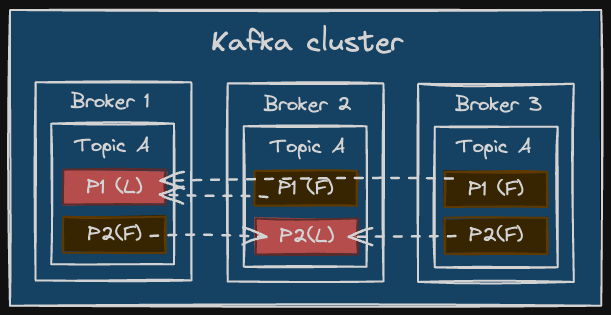

# Kafka yaml 구조


---

- `offsets.topic.replication.factor: 3`

    >  토픽별 파티션 복제 수
    
    - [파티션-Leader] 1 + [파티션-follower] n

---
```
1. wss 로 event 받아오는 ingestion app은 필요없어 보임.

```

- `transaction.state.log.replication.factor: 3`

    > 트랜잭션의 상태 변화(Ongoing, Commit, Abort 등)를 기록하는 내부 관리 토픽(_transaction_state)의 복제 팩터 수

- `transaction.state.log.min.isr: 2`
  
    > 트랜잭션 상태 로그 토픽에 쓰기 작업을 성공으로 인정하기 위해 최소한 살아있어야 하는 동기화된 레플리카(InSycncReplica) 수

