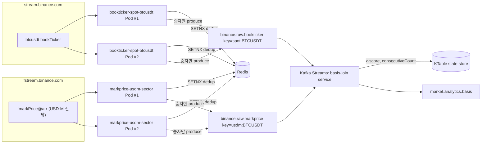

# Insight 1-1. Spot-Futures Basis — 데이터 파이프라인 구현 계획

> 상위 카탈로그: [analyticsInsightsREADME.md](../API/APIdocs/analyticsInsightsREADME.md#insight-1-1-spot-futures-베이시스)
> 토픽/조인 원본: [collectorInsightsREADME.md §7](../API/APIdocs/collectorInsightsREADME.md#7-basis베이시스-조인--spot-trade--usd-m-markprice)

가격 변동성이 클 때 같은 심볼의 **현물(Spot) 가격**과 **무기한 선물(Perpetual) 마크 가격**이 순간적으로
벌어지는 지점을 포착한다. 베이시스가 확대되고 펀딩비가 한쪽으로 쏠리면 과열 신호로 판단한다.

---

## 1. 필요 데이터 (`btc` 기준)

### `btcusdt@bookTicker` (Spot, `stream.binance.com`)

Spot의 최우선 매수/매도 호가가 변경될 때마다 전달된다.

```json
{
  "u": 99397868764,
  "s": "BTCUSDT",
  "b": "78760.56000000",
  "B": "0.27575000",
  "a": "78760.57000000",
  "A": "1.66034000"
}
```

**Spot Mid Price = (b + a) / 2**

### `btcusdt@markPrice` (USD-M, `fstream.binance.com`)

무기한 선물에만 있는 스트림. 1초 주기 고정 push.

```json
{
  "e": "markPriceUpdate",
  "E": 1788098181003,
  "s": "BTCUSDT",
  "p": "78853.70000000",
  "ap": "78853.70000000",
  "P": "78786.58836087",
  "i": "78893.28739130",
  "r": "0.00008778",
  "T": 1788105600000,
  "st": 1
}
```

**Mark Price = p**

## 2. 처리 방식

**실시간 Basis = Mark Price − Spot Mid Price**

두 스트림 모두 `symbol` 키로 co-partitioning되므로 Kafka Streams `KStream-KStream` 윈도우 조인
(5~10초 tumbling/hopping)으로 바로 계산 가능하다.

## 3. 과매도 / 과매수 판단 기준

1. **통계적 임계치**
   - 롤링 윈도우 내 basis의 평균(μ)·표준편차(σ)를 실시간 업데이트 (EMA 또는 Welford's algorithm으로
     순차 갱신, 전체 윈도우 재계산 방지)
   - **Z-Score = (Current Basis − μ) / σ**
   - **과열 판정 임계치**: `|Z| > 2.0` → 1차 후보
2. **시간 윈도우 유지 조건**
   - 최소 3~5개 연속 윈도우 동안 `|Z| > 2.0`이 유지될 때만 알림 발송 (디바운스)
   - `KTable`에 `consecutiveCount` 유지: 임계치 초과 시 +1, 벗어나면 0으로 리셋.
     `consecutiveCount >= 3`이 되는 순간 1회 발행하고 조건이 풀릴 때까지 재발행하지 않는다.

---

## 4. 데이터 파이프라인 구현 계획

### 4.1 전체 흐름



### 4.2 고려 사항 1 — Ingestion Application 구조 설계

**질문**: Ingestion Application을 스트림 1:1로 만들 것인가, 여러 스트림을 한 프로세스가 담당하게
할 것인가?

- **`[Topic] <-> Pod`** 1:1 — 장애 격리 최대, 운영 부담 큼
- **`[product + symbol별] <-> Pod`** — 한 프로세스가 여러 토픽을 다루므로, 장애 시 그 커넥션에 물린
  토픽 전부 같이 끊김
- **모놀리식** — 수평 스케일링 불가

**결정: b (product + symbol별 Pod)**. 특정 심볼의 wss 트래픽이 늘어나면 같은 심볼의 다른 wss도
선형적으로 늘어날 가능성이 높으므로, 수평 스케일링 단위로 적절하다.

**예외**: `markPrice@1s`처럼 트래픽이 고정적인 스트림은 심볼별이 아니라 **섹터별**로 묶는다.

Insight 1-1에 적용하면:

| Pod Group | 구독 대상 | 그룹핑 기준 | 접속 도메인 |
| --- | --- | --- | --- |
| `bookticker-spot-btcusdt` | `btcusdt@bookTicker` | 심볼별 (변동성 기반, 호가 변경마다 push) | `stream.binance.com` |
| `markprice-usdm-sector` | `!markPrice@arr` (USD-M 전체) | 섹터별 (고정 1초 rate) | `fstream.binance.com` |

`markPrice@arr`은 이미 combined stream이라 심볼이 늘어도 pod 증설 없이 하나의 pod group이
전체 USD-M 섹터를 커버한다 — 목표 심볼(btcusdt 등)만 애플리케이션 레벨에서 필터링 후 발행한다.
bookTicker는 심볼당 별도 pod group으로 분리해, 특정 심볼의 호가 변경 빈도가 급증해도 다른 심볼에
영향이 없게 한다.

### 4.3 고려 사항 2 — Fail-Over / HA 구조

**질문**: 토픽을 `Active-Active`로 받을 것인가 `Active-Standby`로 받을 것인가?

- `Active-Standby` (replicas=1, 재시작 기반) — 가장 단순 / 재시작 동안 다운타임
- `Active-Standby` (핫스탠바이 + leader election) — 다운타임 최소화 / 구현 복잡도 추가
- `Active-Active` — 페일오버 공백 거의 0 / 중복 발생이 설계상 필연

**결정: `Active-Active`** (학습 목적). Pod Group당 replica=2, 대상 심볼 1~2개로 최소 유지해 리소스
부담을 없앤다. 위 표의 두 Pod Group 모두 replicas=2로 배포한다 (총 4개 pod, Insight 1-1 기준).

### 4.4 고려 사항 3 — 중복 메시지 처리 (Dedup)

**문제**: Active-Active이므로 동일 심볼을 구독하는 2개 replica가 **동일한 바이낸스 이벤트**를 각자
수신해서 각자 Kafka로 produce하면, 같은 이벤트가 토픽에 두 번 적재된다.

- 선택지
  1. Consumer 단 Redis 기반 Dedup (in-memory 필터링)
  2. Stream Processing Engine (Flink / Kafka Streams) 상태 저장소 기반 dedup
  3. DB Unique Constraint
  4. ClickHouse `ReplacingMergeTree` / Kafka Engine + `Replicated_deduplication_window`

**결정: 1 — Producer 직전 Redis 기반 Dedup (SETNX)**

- **위치**: Consumer(Kafka Streams)가 아니라 **Ingestion Pod가 Kafka에 produce하기 직전**에 적용한다.
  중복 발생 지점(Active-Active replica)에 가장 가깝게 걸러야, `binance.raw.*` 토픽 자체가 항상
  단일 사본만 갖게 되고 이후의 모든 컨슈머(basis join뿐 아니라 향후 다른 Insight의 조인들)가
  이 문제에서 완전히 자유로워진다.
- **키 설계**: `dedup:{product}:{symbol}:{stream}:{event_id}`
  - `bookTicker` → `event_id = u` (update ID, 유니크·단조 증가)
  - `markPrice` → `event_id = E` (event time, push 주기 1초 동안 유니크)
- **동작**: `SET key 1 NX EX <ttl>` — 두 replica 중 먼저 SETNX에 성공한 pod만 Kafka로 produce하고,
  실패한 쪽은 해당 이벤트를 드롭한다. 원자적 연산이라 별도 락이 필요 없다.
- **TTL**: 5~10초. 두 replica 간 수신 시각차(네트워크 지터)보다는 충분히 길고, Redis 메모리 사용은
  최소화하는 값.
- **Redis 장애 시 정책**: fail-open (dedup 체크 실패 시 그냥 produce 허용). Insight 1-1은 분석용
  신호이지 체결/자금 이동이 아니므로, 일시적 중복 유입이 z-score 계산 노이즈를 조금 늘리는 것이
 dedup 계층 장애로 인사이트 전체가 끊기는 것보다 낫다.
- **이유(선택 근거)**:
  - 이미 프로젝트 스토리지 계획(README.md `저장소 역할`)에 Redis가 "최신 가격·지표 캐시" 용도로
    포함되어 있어, 새 인프라 도입 없이 재사용 가능
  - Flink 등 별도 스트림 엔진 도입(옵션 2)보다 학습 스코프에서 훨씬 가볍다
  - DB unique constraint(옵션 3)나 ClickHouse dedup(옵션 4)은 저장 계층에서 걸러지므로, 그 앞단
    (Kafka Streams basis join, 향후 다른 조인들)은 여전히 중복 이벤트를 그대로 받는다 — 조인 결과
    자체가 중복 계산될 위험이 남는다. Producer 단에서 막으면 이 문제가 원천 차단된다.
- **모니터링**: pod별로 `dedup_dropped_total{product,symbol,stream}` 카운터를 노출해, Active-Active
  구조가 실제로 얼마나 중복을 유발하는지 관찰한다 (analyticsInsightsREADME.md의
  [Insight #2 시스템 인사이트](../API/APIdocs/analyticsInsightsREADME.md#2-대규모-유입에-따른-db-병목-및-부하-패턴-분석-시스템-인사이트)와
  같은 대시보드에 겹쳐 볼 수 있다).

### 4.5 Kafka 토픽 / 다운스트림

- `binance.raw.bookticker` — key: `spot:BTCUSDT` (product 접두 복합 키로 심볼 충돌 방지,
  [kafkaTopicsREADME.md §5](../API/APIdocs/kafkaTopicsREADME.md#5-binanceraw-토픽에-product-구분자가-없다--심볼-충돌-위험) 원칙 적용)
- `binance.raw.markprice` — key: `usdm:BTCUSDT`
- `basis-join` Kafka Streams 서비스가 두 토픽을 5~10초 윈도우로 조인해 z-score·연속윈도우 카운트를
  계산하고, 조건 충족 시 `market.analytics.basis`에 알림 이벤트를 1회 발행한다 (디바운스 로직은
  §3 참고).

### 4.6 남은 이슈 / 다음 단계

- Redis가 dedup의 SPOF가 되므로, 운영 전에는 Redis 자체의 가용성(Sentinel/Cluster)도 별도로 검토
  필요 (학습 단계에서는 단일 인스턴스로 진행).
- 현재 Collector(Spring Boot)는 Spot `trade`/`kline`만 수집하는 단일 프로세스 구조([collector/README.md](../collector/README.md))다.
  이 계획대로 가려면 `product+symbol별 Pod` 단위로 애플리케이션을 쪼개는 리팩터링이 선행되어야 한다.
- `bookTicker`/`markPrice` 파서와 Redis dedup 클라이언트를 공통 모듈로 뽑아, 이후 다른 Insight의
  Pod Group에서도 재사용한다.
