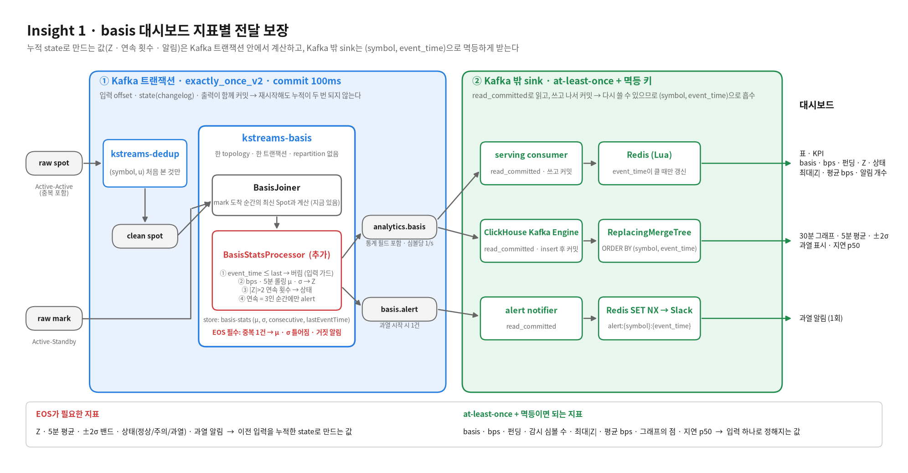

# Insight 1-2. Basis 대시보드 — 지표별 전달 보장과 sink · consumer 설계

[basis 대시보드](basis_dashboard_mock.png)의 지표마다 **중복 · 재처리가 생기면 값이 틀어지는지**를 따져서, exactly-once(EOS)가 꼭 필요한 곳과 at-least-once + 멱등 처리로 충분한 곳을 나눈다. 그리고 지금 파이프라인(Kafka Streams dedup → Kafka Streams basis)에 무엇을 더하고 고칠지 정리한다.



---

## 1. 한 줄 결론

- **EOS가 필요한 것:** 상태를 누적해서 만드는 값. 롤링 μ · σ와 Z, `|Z| > 2` 연속 횟수, 과열 알림이다. 중복이 한 건만 들어가도 평균과 분산이 틀어지고, 연속 횟수가 하나 늘어 **거짓 알림**이 나간다.
  - 이 계산은 Kafka 트랜잭션 안(Kafka Streams EOS)에서 한다.
- **at-least-once + 멱등이면 되는 것:** "지금 값"을 보여 주는 지표와 이력 그래프다. 같은 값이 두 번 와도 `(symbol, event_time)` 기준으로 덮어쓰거나 합치면 한 번 반영한 것과 같다.
- **Kafka 밖 sink(Redis · ClickHouse · 알림)는 어느 엔진이든 EOS 범위 밖이다.** 그래서 sink 쪽 멱등 처리는 반드시 둔다.

---

## 2. 지표별 분류

| 대시보드 요소 | 계산 | 중복 · 재처리가 들어오면 | 필요한 보장 | 어디서 만드나 |
| --- | --- | --- | --- | --- |
| 지금 상태 표: basis · bps · 펀딩 | mark 1건 → 값 1개 | 같은 값으로 한 번 더 덮어씀 (무해) | at-least-once + 덮어쓰기 | basis 출력 → Redis |
| 감시 심볼 수 | Redis에 있는 심볼 수 | 무해 | 없음 | serving (Redis 조회) |
| 최대 \|Z\|, 평균 basis(bps) | 심볼별 최신값의 max · 평균 | 최신값이 맞으면 맞음 | 최신값만 맞으면 됨 | serving (Redis 조회) |
| **Z, 5분 평균, ±2σ 밴드** | 롤링 μ · σ (Welford / EMA) | **μ · σ가 틀어짐** (같은 basis가 두 번 들어감) | **EOS** (계산 단계) | Kafka Streams stats processor |
| **상태 (정상 · 주의 · 과열)** | \|Z\| > 2와 연속 횟수 | **연속 횟수 +1 → 주의가 과열로 바뀜** | **EOS** (계산 단계) | 〃 |
| **과열 알림 (3회 연속 → 1회 발행)** | consecutiveCount ≥ 3인 순간 1회 | **거짓 알림, 재시작 시 같은 알림 재발행** | **EOS** + 알림 발송 멱등 키 | stats processor → alert 토픽 → notifier |
| 과열 · 주의 개수 (KPI) | 지금 status가 과열 · 주의인 심볼 수 | status가 맞으면 맞음 | 위 status를 따름 | serving (Redis 조회) |
| 심볼별 basis 30분 그래프 | 시계열 | 같은 점이 두 번 (멱등 테이블로 흡수) | at-least-once + 멱등 테이블 | ClickHouse `ReplacingMergeTree` |
| 그래프의 과열 표시(점) | 알림 이벤트 | 같은 알림 두 번 → 같은 키로 합침 | 멱등 테이블 | ClickHouse (alert) |
| 지연 p50 | `basis_time − receive_time` 분위수 | 몇 건 중복은 분위수에 거의 영향 없음 | at-least-once + 멱등 테이블 | ClickHouse `quantile` |

**판단 기준:** 그 값이 **이전 입력들을 누적한 state로 만들어지면 EOS**, **입력 하나로 결정되는 최신값이나 시계열의 점이면 멱등**으로 충분하다.

---

## 3. 중복이 생길 수 있는 곳

| 위치 | 원인 | 지금 처리 | 남는 위험 |
| --- | --- | --- | --- |
| raw spot | Active-Active 수집 pod 2개 | kstreams-dedup (EOS)이 `(symbol, u)`로 제거 | 없음 |
| raw mark | Active-Standby라 보통 없음 | — | 수집기 재연결 직후 같은 `E`가 다시 올 가능성 (드묾) → stats에서 `event_time` 가드 |
| 처리 job 재시작 | 마지막 커밋 이후를 다시 처리 | Kafka Streams EOS: 커밋 안 된 출력은 버려진다 (`read_committed`) | 없음 (Flink at-least-once였다면 여기서 중복) |
| **Kafka → 외부 sink** | consumer가 쓰고 offset 커밋 전에 죽으면 다시 씀 | **아직 없음** | **Redis · ClickHouse · 알림 모두 중복 가능 → 멱등 필요** |

---

## 4. TO-BE 구조

```text
raw spot ─▶ kstreams-dedup ─▶ clean spot ─┐
                                          ├─▶ kstreams-basis ─────────────────────────┬─▶ analytics.basis       (심볼당 초당 1건, 통계 필드 포함)
raw mark ─────────────────────────────────┘    BasisJoiner → BasisStatsProcessor      └─▶ analytics.basis.alert (과열 시작 시 1건)
        ◀──────────── Kafka 트랜잭션 (exactly_once_v2, commit 100ms) ───────────▶

analytics.basis ─(read_committed)─▶ serving consumer ─▶ Redis (event_time 가드) ─▶ Pub/Sub ─▶ WebSocket ─▶ 표 · KPI
analytics.basis ─(read_committed)─▶ ClickHouse Kafka Engine ─▶ ReplacingMergeTree ─▶ 30분 그래프 · 지연 p50
analytics.basis.alert ─(read_committed)─▶ alert notifier ─▶ Redis SET NX (알림 키) ─▶ Slack 등
        ◀──────────── at-least-once + 멱등 키 (symbol, event_time) ───────────▶
```

### 4.1 바꿀 곳: kstreams-basis에 stats processor 추가

새 앱을 만들지 않고 **basis와 같은 topology 안**에 둔다. 키가 이미 심볼이라 repartition이 없고, join과 통계가 같은 트랜잭션으로 커밋된다.

```java
// BasisTopology.build (추가 부분)
// 3. join (지금과 같음)
KStream<String, Basis> basis = mark.join(latestSpot, new BasisJoiner(), Joined.with(...).withName("basis"));

// 4. 통계 · 상태 · 알림 (심볼별 state: μ, σ, consecutiveCount, lastEventTime)
//   - store "basis-stats"는 changelog로 복구된다. EOS라 재시작해도 같은 basis가 두 번 누적되지 않는다
KStream<String, BasisStats> stats = basis
        .filter((symbol, value) -> value != null, Named.as("fresh.basis"))
        .process(() -> new BasisStatsProcessor(statsWindow, zThreshold, consecutiveForAlert),   // = ProcessorSupplier.get()
                Named.as("basis.stats"),
                "basis-stats");

// 5. 출력 두 개 (같은 트랜잭션)
stats.to(BASIS_TOPIC, Produced.with(...).withName("analytics.basis"));
stats.filter((symbol, value) -> value.alertStarted(), Named.as("alert.started"))
     .to(ALERT_TOPIC, Produced.with(...).withName("analytics.basis.alert"));
```

`BasisStatsProcessor`가 레코드 하나마다 하는 일:

1. `event_time <= lastEventTime`이면 버린다. 수집기 재연결로 같은 mark가 다시 오는 경우를 막는 가드다. EOS와 별개로, 입력 중복을 막는 마지막 방어선이다.
2. `bps = basis / spot_mid × 10,000`을 계산한다.
3. 5분 롤링 μ · σ를 갱신한다 (EMA 또는 Welford). `z = (bps − μ) / σ`를 구한다.
4. `|z| > 2`이면 `consecutive + 1`, 아니면 0으로 되돌린다.
5. `status`를 정한다: 정상 / 주의(연속 < 3) / 과열(연속 ≥ 3).
6. `consecutive`가 **정확히 3이 되는 순간에만** `alertStarted = true`로 둔다 (한 번만 발행).

출력 필드: 지금 basis 출력에 `bps`, `mean_bps`, `std_bps`, `z`, `consecutive`, `status`, `alert_started`를 더한다. 가격처럼 `BigDecimal` 문자열로 쓰고, 통계 값은 `double`도 된다.

### 4.2 새로 만들 곳: serving consumer → Redis

- **읽기:** Spring Kafka, `isolation.level=read_committed`, `enable.auto.commit=false`.
- **커밋 순서:** Redis 반영 후 offset을 커밋한다. 쓰고 죽으면 다시 쓰게 되므로 at-least-once다.
- **멱등:** Lua 스크립트로 **event_time이 더 클 때만** 반영하고 publish한다. 재처리분이나 늦게 온 옛 값은 무시된다.

```lua
-- KEYS[1] = latest:usdm:BTCUSDT:basis   ARGV[1] = event_time   ARGV[2] = JSON   ARGV[3] = 채널
local current = redis.call('HGET', KEYS[1], 'event_time')
if current and tonumber(current) >= tonumber(ARGV[1]) then
  return 0                                   -- 같은 값이거나 더 옛 값 → 무시 (멱등)
end
redis.call('HSET', KEYS[1], 'event_time', ARGV[1], 'json', ARGV[2])
redis.call('PUBLISH', ARGV[3], ARGV[2])      -- Gateway들이 구독 → WebSocket push
return 1
```

- KPI(최대 |Z|, 평균 bps, 과열 · 주의 개수, 감시 심볼 수)는 Gateway가 Redis의 심볼별 최신값으로 계산한다. 최신값이 멱등하게 맞으므로 KPI도 맞다.

### 4.3 새로 만들 곳: ClickHouse (그래프 · 지연)

```sql
-- 1. Kafka에서 읽는 테이블 (librdkafka의 isolation.level 기본값이 read_committed지만 명시해 둔다)
CREATE TABLE basis_queue (... 필드 ...)
ENGINE = Kafka SETTINGS kafka_broker_list = '...', kafka_topic_list = 'binance.analytics.crypto.basis',
                        kafka_group_name = 'clickhouse-basis', kafka_format = 'JSONEachRow';

-- 2. 실제 저장. 같은 (symbol, event_time)은 merge 때 한 건으로 합쳐진다 (멱등)
CREATE TABLE basis (... 필드 ...)
ENGINE = ReplacingMergeTree(basis_time)
ORDER BY (symbol, event_time);

CREATE MATERIALIZED VIEW basis_mv TO basis AS SELECT * FROM basis_queue;
```

- Kafka Engine은 블록을 insert한 뒤 offset을 커밋하므로 at-least-once다. 그래서 `ReplacingMergeTree`가 꼭 필요하다.
- 조회는 `FINAL`을 붙이거나 `argMax`를 쓴다. merge 전에는 중복이 잠깐 보일 수 있기 때문이다.
- 지연 p50: `SELECT symbol, quantile(0.5)(basis_time - receive_time) FROM basis FINAL WHERE ...`
- 알림 이력은 `basis_alert` 테이블에 같은 방식(`ORDER BY (symbol, event_time)`)으로 둔다.

### 4.4 새로 만들 곳: alert notifier

- **읽기:** `analytics.basis.alert`를 `read_committed`로 읽는다. 커밋 전 알림은 보이지 않는다.
- **멱등:** 보내기 전에 `SET alert:{symbol}:{event_time} 1 NX EX 86400`을 한다.
  - 성공했을 때만 Slack으로 보낸다.
  - 재처리로 같은 알림이 다시 와도 키가 이미 있어서 보내지 않는다.
- **남는 경우:** 보낸 뒤 키 저장 전에 죽는 경우는 순서를 "키 먼저, 전송 나중"으로 해서 **최대 1번 누락**으로 바꾼다. 알림이 두 번 가는 것보다 한 번 빠지는 쪽이 낫다는 판단이다. 반대가 필요하면 순서를 바꾼다.

---

## 5. 만약 basis를 Flink로 둔다면

| 항목 | Flink에서 필요한 것 |
| --- | --- |
| Z · 연속 횟수 · 알림 | sink를 at-least-once로 두면 재시작 때 체크포인트 이후 basis가 **stats state에 다시 누적되지는 않는다** (state도 체크포인트로 되돌아가므로). 하지만 **출력(알림)은 두 번 나간다** → notifier 멱등 키 필수 |
| 출력 지연 | `EXACTLY_ONCE` sink + `read_committed`면 체크포인트 간격만큼 늦게 보인다 (basis 10s). Redis 쪽만 `read_uncommitted`로 읽어 빠르게 받는 방법이 있다 (같은 토픽, isolation level로 층을 나눔) |
| 그 밖 | Redis · ClickHouse 멱등 처리는 Kafka Streams일 때와 같다 |

Kafka Streams에서는 커밋이 100ms라서 모든 consumer가 `read_committed`로 읽어도 대시보드가 충분히 빠르다. 그래서 층을 나눌 필요가 없다.

---

## 6. 할 일

| 순서 | 작업 | 위치 |
| --- | --- | --- |
| 1 | `BasisStatsProcessor` + store `basis-stats`, 출력 필드 추가, alert 출력 | `consumer/clean_analytics/kstreams-join` |
| 2 | 토픽 `binance.analytics.crypto.basis.alert` | `Infra/Kafka/Kafka-Topic/binance/analytics/crypto/` |
| 3 | serving consumer (Redis Lua · Pub/Sub) | `servingapp/` |
| 4 | ClickHouse `basis`, `basis_alert` 테이블 · Kafka Engine · MV | `Infra/ClickHouse/` |
| 5 | alert notifier (Redis SET NX → Slack) | `servingapp/` 또는 별도 앱 |
| 6 | 테스트: 같은 mark 두 번 → μ · σ · consecutive 그대로 / 재시작 → 알림 1회 / Redis에 옛 event_time → 무시 | 각 앱 `src/test` |
