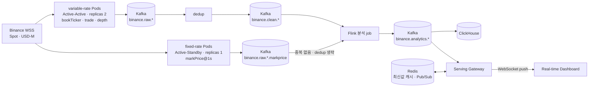

# Binance Real-Time Market Insight Platform

Binance WebSocket 시장 데이터를 실시간으로 수집·스트리밍해, 시장 간 가격 괴리와 이상 신호를 탐지하는
분석 인사이트를 만들어보는 개인 프로젝트입니다. Kafka 기반 이벤트 파이프라인과 Flink 스트림 처리를
Kubernetes 위에 직접 설계하고 구현하며 학습하는 것이 목적입니다.

## 프로젝트 개요

- **문제 의식**: Binance는 Spot/USD-M/COIN-M/Options 등 여러 시장을 동시에 운영하고, 같은
  기초자산(BTC 등)의 가격이 시장마다 미세하게 다르게 움직인다. 최근에는 미국 주식도 USD-M
  TradFi 무기한 선물로 24시간 거래된다. 이 괴리(베이시스, 펀딩비 쏠림, 정규장 외 괴리 등)를
  실시간으로 포착하는 것이 이 프로젝트의 핵심 도메인이다.
- **접근 방식**: Binance WebSocket을 직접 구독하는 Ingestion Pod를 만들고, 원본 이벤트를 Kafka로
  스트리밍한 뒤, Flink로 여러 스트림을 조인해 인사이트를 계산한다. 결과는 저장소에 쌓고 대시보드로
  보여준다.
- **학습 목표**: 파이프라인을 만드는 것에서 끝나지 않고, Active-Active 이중화, 중복 제거,
  co-partitioning 같은 분산 시스템 설계 문제를 직접 결정하고 근거를 남기는 것.
  결정 과정은 [`plan/`](plan/) 문서에 "선택 옵션 → 선택 → 이유" 형식으로 기록한다.

### 전체 스트림 설계 구조



| 구성요소 | 역할 |
| --- | --- |
| Ingestion Pod | Binance WSS 구독 → envelope로 감싸 Kafka raw 토픽에 발행. product + 심볼(또는 섹터) 단위로 Pod 분리 |
| Kafka (Strimzi, KRaft) | 이벤트 버퍼·전달·재처리. `raw` → `clean` → `analytics` 3단계 토픽 |
| Flink | dedup, 스트림 조인(basis 등), 실시간 지표 계산 |
| ClickHouse | 대량 시계열 분석·조회 |
| Redis | 서빙 계층의 최신값 캐시와 WebSocket fan-out(Pub/Sub). Ingestion dedup 상태 저장 후보 |
| Serving Gateway | analytics 결과를 WebSocket으로 클라이언트에 push |
| Dashboard | 분석 결과 실시간 시각화 |

---

## 주요 설계 결정

자세한 근거와 검토한 다른 옵션은 각 문서에 있다.

| 주제 | 결정 | 문서 |
| --- | --- | --- |
| Ingestion 구성 단위 | **product + 심볼 단위 Pod.** 트래픽이 일정한 `markPrice@1s`는 섹터 단위로 묶어 별도 그룹(fixed-rate)으로 분리 | [ingestion/plan.md](plan/ingestion/plan.md) |
| HA | variable-rate 그룹은 **Active-Active (replicas 2)**, fixed-rate 그룹은 **Active-Standby (replicas 1)** | [ingestion/plan.md](plan/ingestion/plan.md) |
| 중복 제거 | Active-Active라 같은 이벤트가 두 번 들어옴. 거래소 고유값(`t`, `a`, `u`)을 키로 제거. 위치(Ingestion 단 Redis vs Flink)는 [남은 과제](#남은-과제) 참고 | [ingestion/plan.md](plan/ingestion/plan.md), [topic/plan.md](plan/topic/plan.md) |
| 토픽 분리 단위 | **product × 자산종류 × 스트림.** 한 토픽에는 한 스키마만. crypto와 stock은 소비자·트래픽 성격이 달라 분리, 섹터는 envelope `sector` 필드로 구분 | [topic/plan.md](plan/topic/plan.md) |
| 토픽 이름 | `binance.<raw\|clean\|analytics>.<spot\|usdm>.<crypto\|stock>.<stream>` | [topic/plan.md](plan/topic/plan.md) |
| 키와 파티션 | 키는 **심볼**. 조인할 토픽끼리 파티션 수를 맞춰 co-partitioning 보장 (crypto 3, stock 6) | [topic/plan.md](plan/topic/plan.md) |
| basis 조인 방식 | 윈도우 조인 대신 `KeyedCoProcessFunction`으로 최신 Spot mid를 state에 두고 markPrice가 올 때 계산 | [topic/insight_1_plan.md](plan/topic/insight_1_plan.md) |
| 서빙 | REST 폴링 대신 WebSocket push. 접속 직후 값은 Redis 캐시로, Gateway 간 fan-out은 Redis Pub/Sub | [servingapp/plan.md](servingapp/plan.md) |

### 수집 대상

| 자산 | product | 심볼 | 그룹 |
| --- | --- | --- | --- |
| crypto | Spot | BTCUSDT | variable-rate |
| crypto | USD-M | BTCUSDT | variable-rate + fixed-rate(markPrice) |
| stock (광학) | USD-M | LITEUSDT, CRDOUSDT, ALABUSDT | variable-rate + fixed-rate(markPrice) |
| stock (반도체) | USD-M | NVDAUSDT, AVGOUSDT, MRVLUSDT | variable-rate + fixed-rate(markPrice) |

Deployment 7개, Pod 11개, WebSocket 연결 27개로 구성된다. 심볼 선정 기준은
[0TickerInfoTable.md](APIdocs/0TickerInfoTable.md), Pod별 구독 URL은
[ingestion/plan.md](plan/ingestion/plan.md#ingestion-pod-구성도)에 있다.

---

## 저장소 구조

```text
.
├── APIdocs/               Binance REST/WebSocket 조사 문서, 수집 심볼 표, 검증용 노트북(APIpoc/)
├── plan/                  설계 결정 기록
│   ├── ingestion/         Ingestion Pod 구성, HA, 중복 제거
│   ├── topic/             Kafka 토픽 설계, Insight 1 토픽 흐름
│   └── consumer/          (예정)
├── datasource-ingestion/  Ingestion 앱
│   ├── collector/         현재 동작하는 Spring Boot POC
│   └── core/ app/ config/ deploy/   POC 이후 리팩터링할 목표 구조 (자리만 있음)
├── Infra/                 kind 클러스터, Strimzi Kafka, Flink Operator 설치
├── Insights/              인사이트 카탈로그와 인사이트별 구현 계획·분석 노트북
└── servingapp/            서빙 계층 설계와 POC
```

---

## 구현 목표 체크리스트

인사이트가 몇 개든 한 번만 만들면 되는 **공통 인프라**와, 인사이트가 늘어날 때마다 반복해야 하는
**인사이트별 구현**을 구분한다. 공통 파트가 튼튼해질수록 인사이트 하나를 추가하는 비용이 줄어드는
구조를 목표로 한다.

### A. 공통 인프라

#### A-0. 리서치 · 설계 문서화

- [x] Binance REST/WebSocket API 조사 및 정리 ([binanceAPIREADME.md](APIdocs/binanceAPIREADME.md))
- [x] Product별(Spot/USD-M/COIN-M/Options) Market Stream 필드 정리
- [x] User Data Stream(계정 이벤트) 정리
- [x] 수집 심볼 선정 ([0TickerInfoTable.md](APIdocs/0TickerInfoTable.md))
- [x] 인사이트 카탈로그 작성 ([analyticsInsightsREADME.md](Insights/analyticsInsightsREADME.md))
- [x] Ingestion Pod 구성 · HA 설계 ([ingestion/plan.md](plan/ingestion/plan.md))
- [x] Kafka 토픽 설계 ([topic/plan.md](plan/topic/plan.md))
- [x] 서빙 계층 설계 ([servingapp/plan.md](servingapp/plan.md))

#### A-1. Ingestion

- [x] Spring Boot POC: Spot `bookTicker` + USD-M `markPrice` 수신·파싱 ([collector/](datasource-ingestion/collector/), Kafka 발행은 아직 로그만)
- [ ] WebSocket 클라이언트 고도화 (exponential backoff, 24시간 커넥션 만료 전 make-before-break)
- [ ] Product별 파서 분리 (Spot vs USD-M 필드 스키마 차이 반영)
- [ ] combined stream(`/stream?streams=`) 지원과 섹터 단위 구독
- [ ] variable-rate / fixed-rate config 분리와 Pod화 (`core/`, `app/`, `config/`, `deploy/`)
- [ ] Kafka Producer 연동: envelope(`source`, `product`, `asset_class`, `sector`, `stream`,
      `symbol`, `event_time`, `receive_time`, `collector_id`, `payload`) 적용
- [ ] Active-Active 배포 (variable-rate replicas 2)와 dedup 적용
- [ ] Ingestion metric 노출 (`binance_ws_connected`, `binance_event_lag_ms`, `dedup_dropped_total` 등)

#### A-2. Kafka · 스트림 처리 인프라

- [x] kind 클러스터 구성 (control-plane 1 + worker 2, [kind-study.yaml](Infra/kind-study.yaml))
- [x] Strimzi Kafka 클러스터 매니페스트 (KRaft, Kafka 4.3.1, 브로커 3, [kafka-cluster.yaml](Infra/Kafka/Kafka-Cluster/kafka-cluster.yaml))
- [x] Kafka UI (NodePort 30080, [kafka-ui.yaml](Infra/Kafka/Kafka-Cluster/kafka-ui.yaml))
- [x] 토픽 이름 규칙 · 키 · 파티션 · 보존 정책 확정
- [ ] 토픽별 Strimzi `KafkaTopic` yaml 작성 (`Infra/Kafka/Kafka-Topic/binance/{raw,clean,analytics}/`)
- [ ] `retention.bytes`를 브로커 디스크(5Gi)에 맞게 재설정
- [ ] cert-manager + Flink Kubernetes Operator 설치
- [ ] Schema Registry 도입 여부 결정 (Avro/Protobuf vs JSON)
- [ ] 가격/수량 필드 decimal 타입 처리 정책 확정

#### A-3. 저장 및 서빙

- [ ] ClickHouse 공통 스키마(인사이트 결과 공용 테이블) 설계 및 적재 파이프라인
- [ ] Redis 구성 (최신값 캐시, Pub/Sub fan-out)
- [ ] Serving Gateway 구현 (WebSocket push, 접속 시 초기값, 심볼별 전송 간격 제어)

#### A-4. 대시보드

- [x] 서빙 화면 POC ([servingapp/poc/index.html](servingapp/poc/index.html))
- [ ] 실시간 가격·거래량 기본 뷰
- [ ] 인사이트 알림을 꽂을 수 있는 공용 위젯 레이아웃

#### A-5. 운영 고도화

- [ ] Prometheus/Grafana 운영 metric 대시보드
- [ ] 실제 유입량 측정 후 보존 기간·디스크 재계산
- [ ] 단계별 지연 측정 (`receive_time` → raw → clean → analytics)
- [ ] 부하 테스트 (depth@100ms on/off 비교, 배치 삽입 전략 비교)
- [ ] 장애 주입 테스트 (Active-Active 페일오버, dedup 저장소 장애 시 동작 검증)
- [ ] API 키 권한 분리 점검 (Ingestion은 조회 전용, 주문 기능은 별도 키/프로세스)

### B. 인사이트별 구현

각 인사이트는 **① 구현 계획 문서화 → ② Flink 스트림 구현 → ③ 결과 저장(A-3 스키마에 적재) →
④ 대시보드 반영** 순서를 따른다.

| Insight | ① 계획 문서화 | ② 스트림 구현 | ③ 저장 연동 | ④ 대시보드 |
| --- | --- | --- | --- | --- |
| 1-1. Spot-Futures Basis | [x] [구현 계획](Insights/1.spot_futures_basis/1_1_plan.md), [토픽 흐름](plan/topic/insight_1_plan.md) | [ ] | [ ] | [ ] |
| 1-2. 선물 캘린더 스프레드 | [ ] | [ ] | [ ] | [ ] |
| 1-3. 옵션 스트래들 매도 | [ ] | [ ] | [ ] | [ ] |
| 3-1. 고래 거래 감지 | [ ] | [ ] | [ ] | [ ] |
| 3-2. 오더북 심층 분석(스푸핑) | [ ] | [ ] | [ ] | [ ] |
| 4. 리드-래그 탐지 | [ ] | [ ] | [ ] | [ ] |
| 5. 체결 품질(슬리피지) | [ ] | [ ] | [ ] | [ ] |
| 6. 실시간 포트폴리오 평가액 | [ ] | [ ] | [ ] | [ ] |
| 7. 펀딩비 쏠림 탐지 | [ ] | [ ] | [ ] | [ ] |
| 8. COIN-M vs USD-M 베이시스 비교 | [ ] | [ ] | [ ] | [ ] |
| 9. 옵션 PCR·IV 스큐 | [ ] | [ ] | [ ] | [ ] |
| 10. TradFi Perpetual 정규장 외 괴리 | [ ] | [ ] | [ ] | [ ] |
| 11. 실시간 시장 스캐너 | [ ] | [ ] | [ ] | [ ] |

번호는 [analyticsInsightsREADME.md](Insights/analyticsInsightsREADME.md)의 카탈로그 번호와 맞춘다.
새 인사이트를 추가할 때는 이 표에 행을 추가하고, 인사이트별 구현 계획 문서를 `Insights/` 아래에 만든다.

---

## 문서

### 설계 (`plan/`)

| 문서 | 내용 |
| --- | --- |
| [ingestion/plan.md](plan/ingestion/plan.md) | Ingestion Pod 구성 단위, Active-Active/Standby, 중복 제거, Pod별 구독 URL |
| [topic/plan.md](plan/topic/plan.md) | 토픽 분리 기준, 이름 규칙, 토픽 목록, 키·파티션, envelope, 토픽 관계도 |
| [topic/insight_1_plan.md](plan/topic/insight_1_plan.md) | Insight 1-1의 토픽 흐름, Flink dedup·basis join job, 단계별 지연 측정 |
| [servingapp/plan.md](servingapp/plan.md) | 서빙 계층: push 구조, 초기값, Gateway 스케일, 전송 빈도 제어 |
| [datasource-ingestion/README.md](datasource-ingestion/README.md) | Ingestion 앱 폴더 구조와 POC 실행 방법 |

### Binance API 조사 (`APIdocs/`)

| 문서 | 내용 |
| --- | --- |
| [0TickerInfoTable.md](APIdocs/0TickerInfoTable.md) | 수집 심볼 목록 (BTC, 광학·반도체 TradFi 무기한 선물) |
| [binanceAPIREADME.md](APIdocs/binanceAPIREADME.md) | REST/WebSocket 전반, 인증, rate limit |
| [binanceWebSocketREADME.md](APIdocs/binanceWebSocketREADME.md) | product별 도메인 분류, 커넥션 운영 규칙 |
| [spotMarketStreamREADME.md](APIdocs/spotMarketStreamREADME.md) | Spot Market Stream 필드 |
| [usdmFuturesMarketStreamREADME.md](APIdocs/usdmFuturesMarketStreamREADME.md) | USD-M Futures Market Stream 필드 |
| [coinmFuturesMarketStreamREADME.md](APIdocs/coinmFuturesMarketStreamREADME.md) | COIN-M Futures Market Stream 필드 |
| [optionsMarketStreamREADME.md](APIdocs/optionsMarketStreamREADME.md) | Options Market Stream 필드 (WebSocket 연결 미검증) |
| [userDataStreamREADME.md](APIdocs/userDataStreamREADME.md) | 계정 이벤트(주문/잔고/포지션) 스트림 |
| [kafkaTopicsREADME.md](APIdocs/kafkaTopicsREADME.md) | 초기 토픽 설계 초안과 조인 아이디어 (현재 토픽 설계는 [topic/plan.md](plan/topic/plan.md)) |
| [collectorInsightsREADME.md](APIdocs/collectorInsightsREADME.md) | 시장별 스키마 차이, 토픽/키 설계 시 주의점 |

`APIdocs/APIpoc/`에는 각 시장 WebSocket을 실제로 연결해본 검증용 Jupyter 노트북이 있다.

## Insights

- **Spot-Futures Basis**: 현물 mid price와 무기한 선물 마크 가격의 괴리를 Z-Score와 연속 윈도우
  조건으로 판정해 과열 신호를 탐지한다. ([구현 계획](Insights/1.spot_futures_basis/1_1_plan.md))
- **TradFi Perpetual 정규장 외 괴리**: 미국 주식 시장이 닫힌 시간에 주식 무기한 선물 가격이
  어떻게 움직이는지 추적한다.
- **청산 캐스케이드**: 대량 강제 청산(`forceOrder`) 전후 가격 충격과 거래량 급증 여부를 측정한다.
- **고래 거래·오더북 심층 분석**: 대량 체결과 매수/매도벽, 스푸핑 후보를 탐지한다.
- **리드-래그, 펀딩비 쏠림, 옵션 심리 지표** 등: 전체 목록은
  [인사이트 카탈로그](Insights/analyticsInsightsREADME.md) 참고.

---

## 개발 환경

| 영역 | 기술 |
| --- | --- |
| 클러스터 | Kubernetes (kind), cert-manager |
| 메시징 | Apache Kafka 4.3.1 (Strimzi Operator, KRaft), Kafka UI |
| 스트림 처리 | Apache Flink (Flink Kubernetes Operator 1.12) |
| Ingestion | Java 17, Spring Boot 4, JDK `HttpClient` WebSocket |
| 저장 · 캐시 | ClickHouse, Redis |
| 서빙 · 화면 | WebSocket Gateway, 웹 대시보드 |

## 운영 시 주의사항

- Binance WebSocket 재연결과 backoff를 구현한다. 단일 커넥션은 24시간마다 끊기므로
  make-before-break 방식으로 전환한다.
- USD-M은 스트림 종류에 따라 경로 접두어가 다르다 (`/public`: bookTicker·depth, `/market`:
  aggTrade·markPrice). 접두어를 틀리면 연결은 되지만 메시지가 오지 않는다.
- `event_time`과 `receive_time`을 모두 기록해 지연시간을 측정한다.
- Kafka 키는 심볼로 지정해 심볼 단위 순서를 보존하고, 조인할 토픽끼리 파티션 수를 맞춘다.
- Spot과 USD-M은 같은 스트림이라도 필드 스키마가 다르므로 같은 파서·토픽으로 처리하지 않는다.
- Order book은 REST snapshot과 diff stream을 규칙에 맞게 동기화한다.
- 수집 심볼은 하드코딩하지 않고 `exchangeInfo`에서 `TRADING` 상태인 것만 구독한다.
- 주문 기능을 추가하더라도 Ingestion 프로세스의 API 키에는 `TRADE`/출금 권한을 부여하지 않는다.
- 이 프로젝트는 투자 조언이 아닌 시장 데이터 분석 도구를 목표로 한다.

## 남은 과제

- **중복 제거 위치 통일**: [ingestion/plan.md](plan/ingestion/plan.md)는 Ingestion 단 Redis
  `SETNX`를 선택했고, [topic/plan.md](plan/topic/plan.md)와
  [insight_1_plan.md](plan/topic/insight_1_plan.md)는 Flink dedup으로 `clean` 토픽을 만드는
  구조다. 하나로 정한 뒤 `clean` 단계의 필요 여부를 다시 정리한다.
- **분석 엔진 표기 통일**: [servingapp/plan.md](servingapp/plan.md)와
  [1_1_plan.md](Insights/1.spot_futures_basis/1_1_plan.md)는 Kafka Streams와 이전 토픽
  이름(`market.analytics.basis`)을 기준으로 쓰여 있다. 현재 설계(Flink,
  `binance.analytics.crypto.basis`)에 맞춰 고친다.
- **collector 토픽·키 반영**: POC의 토픽 이름(`binance.raw.bookticker`)과 키(`spot:BTCUSDT`)를
  [topic/plan.md](plan/topic/plan.md) 규칙으로 바꾼다.
