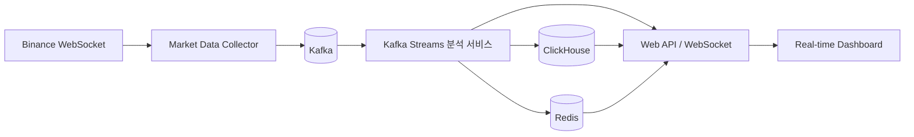

# Binance Real-Time Market Insight Platform

Binance WebSocket 시장 데이터를 실시간으로 수집·스트리밍해, 차익거래 기회·이상 신호를 탐지하는
분석 인사이트를 만들어보는 개인 프로젝트입니다. Kafka 기반 이벤트 파이프라인과 Kafka Streams
실시간 조인/집계를 직접 설계하고 구현하며 학습하는 것이 목적입니다. (CDC/Debezium은 이 파이프라인
안에서 검토했던 여러 구성요소 중 하나일 뿐, 프로젝트 전체의 정체성은 아닙니다.)

## 프로젝트 개요

- **문제 의식**: Binance는 Spot/USD-M/COIN-M/Options 등 여러 시장을 동시에 운영하고, 같은
  기초자산(BTC 등)의 가격이 시장마다 미세하게 다르게 움직인다. 이 괴리(스프레드, 베이시스, 펀딩비
  쏠림 등)를 실시간으로 포착하는 것이 이 프로젝트의 핵심 도메인이다.
- **접근 방식**: Binance WebSocket을 직접 구독하는 Collector를 만들고, 원본 이벤트를 Kafka로
  스트리밍한 뒤, Kafka Streams로 여러 스트림을 조인해 인사이트를 계산한다. 결과는 저장소에 쌓고
  대시보드로 보여준다.
- **학습 목표**: 단순 데이터 파이프라인 구축을 넘어, Active-Active 이중화·중복 제거·co-partitioning
  같은 분산 시스템 설계 고민을 직접 결정하고 근거를 남기는 것 (예: [Insight 1-1 구현 계획](#insights)).

### 전체 구조

| 구성요소 | 역할 |
| --- | --- |
| Collector | Binance Market/User Data Stream 구독 → Kafka 발행. product(Spot/USD-M/COIN-M/Options)별 커넥션·파서 분리 |
| Kafka | 이벤트 버퍼·전달·재처리. `binance.raw.*`(시장 데이터) / `binance.account.*`(계정 데이터) 토픽 분리 |
| Kafka Streams | `KStream-KStream`/`KTable` 윈도우 조인으로 베이시스·청산 캐스케이드·슬리피지 등 실시간 계산 |
| ClickHouse | 대량 시계열 분석·조회 |
| Redis | 최신 가격/지표 캐시, 웹소켓 fan-out, Ingestion dedup 상태 저장 |
| Dashboard | 분석 결과 실시간 시각화 |

---

## 구현 목표 체크리스트

인사이트가 몇 개든 상관없이 한 번만 만들면 되는 **공통 인프라**와, 인사이트가 늘어날 때마다
매번 반복해야 하는 **인사이트별 구현**을 구분한다. 공통 파트가 튼튼해질수록 인사이트 하나를
추가하는 비용이 줄어드는 구조를 목표로 한다.

### A. 공통 인프라

#### A-0. 리서치 · 문서화

- [x] Binance REST/WebSocket API 조사 및 정리 ([binanceAPIREADME.md](APIdocs/binanceAPIREADME.md))
- [x] Product별(Spot/USD-M/COIN-M/Options) Market Stream 필드 정리
- [x] User Data Stream(계정 이벤트) 정리
- [x] Kafka 토픽·키 설계 초안 ([kafkaTopicsREADME.md](APIdocs/kafkaTopicsREADME.md))
- [x] 인사이트 카탈로그 작성 (analyticsInsightsREADME)

#### A-1. Collector

- [ ] WebSocket 클라이언트 기본 골격 (재연결/backoff, 24시간 커넥션 만료 전 make-before-break)
- [ ] Product별 파서 분리 (Spot vs USD-M vs COIN-M vs Options 필드 스키마 차이 반영)
- [ ] product + symbol 단위 Pod 구조로 재구성 (고정 rate 스트림은 섹터 단위로 예외 처리)
- [ ] Kafka Producer 연동 — envelope 스키마(`source`, `product`, `event_type`, `symbol`,
      `event_time`, `receive_time`, `payload`) 적용
- [ ] Active-Active 이중화 (replica=2) 배포
- [ ] Redis `SETNX` 기반 producer-side dedup 적용
- [ ] Collector 자체 metric 노출 (`binance_ws_connected`, `binance_event_lag_ms`,
      `dedup_dropped_total` 등)

#### A-2. Kafka 파이프라인

- [ ] Strimzi Kafka 클러스터 배포 (버전 호환성 재검토 — 기존 자산은 0.17.0로 오래됨)
- [ ] `binance.raw.*` / `binance.account.*` 토픽 생성 및 ACL 분리
- [ ] Schema Registry 도입 여부 결정 (Avro/Protobuf vs JSON)
- [ ] 가격/수량 필드 decimal 타입 처리 정책 확정

#### A-3. 저장 및 서빙

- [ ] ClickHouse 공통 스키마(인사이트 결과 공용 테이블 형태) 설계 및 적재 파이프라인
- [ ] Redis 캐시 계층(최신 지표, dedup 상태) 구성
- [ ] Web API / WebSocket API 서버 골격 구축 (인사이트 결과를 얹기만 하면 되는 형태)

#### A-4. 대시보드 셸

- [ ] 실시간 가격·거래량 기본 뷰
- [ ] 인사이트 알림을 꽂을 수 있는 공용 알림/위젯 레이아웃

#### A-5. 운영 고도화

- [ ] Prometheus/Grafana 등 운영 metric 대시보드 구축
- [ ] 부하 테스트 (depth@100ms on/off 비교, 배치/COPY 삽입 전략 비교)
- [ ] 장애 주입 테스트 (Active-Active 페일오버, Redis dedup 장애 시 fail-open 검증)
- [ ] API 키 권한 분리 점검 (Collector는 조회 전용, 주문 기능은 별도 키/프로세스)

### B. 인사이트별 구현

각 인사이트는 **① 구현 계획 문서화 → ② Kafka Streams 조인/집계 구현 → ③ 결과 저장(A-3 스키마에
적재) → ④ 대시보드 반영(A-4 셸에 위젯 추가)** 순서를 따른다. 아래는 인사이트별 진행 상태.

| Insight | ① 계획 문서화 | ② 스트림 구현 | ③ 저장 연동 | ④ 대시보드 |
| --- | --- | --- | --- | --- |
| 1-1. Spot-Futures Basis | [x] [구현 계획](../Insight/1_1_plan.md) | [ ] | [ ] | [ ] |
| 1-2. 선물 캘린더 스프레드 | [ ] | [ ] | [ ] | [ ] |
| 1-3. 옵션 스트래들 매도 | [ ] | [ ] | [ ] | [ ] |
| 3-1. 고래 거래 감지 | [ ] | [ ] | [ ] | [ ] |
| 3-2. 오더북 심층 분석(스푸핑) | [ ] | [ ] | [ ] | [ ] |
| 4. 리드-래그 탐지 | [ ] | [ ] | [ ] | [ ] |
| 5. 체결 품질(슬리피지) | [ ] | [ ] | [ ] | [ ] |
| 6. 실시간 포트폴리오 평가액 | [ ] | [ ] | [ ] | [ ] |
| 7. 펀딩비 쏠림 탐지 | [ ] | [ ] | [ ] | [ ] |
| 8. COIN-M vs USD-M 베이시스 비교 | [ ] | [ ] | [ ] | [ ] |
| 9. 옵션 PCR·IV 스큐 | [ ] | [ ] | [ ] | [ ] |
| 10. TradFi Perpetual 정규장外 괴리 | [ ] | [ ] | [ ] | [ ] |
| 11. 실시간 시장 스캐너 | [ ] | [ ] | [ ] | [ ] |

번호는 `analyticsInsightsREADME.md`의 인사이트 카탈로그 번호와 맞춘다. 새 인사이트를 추가할 때는
이 표에 행을 추가하고, 해당 인사이트만의 구현 계획 문서(`Insight/{번호}_plan.md`)를 만든다.

---

## API 문서

Binance API/WebSocket을 조사하며 정리한 참고 문서.

| 문서 | 내용 |
| --- | --- |
| [binanceAPIREADME.md](APIdocs/binanceAPIREADME.md) | REST/WebSocket 전반, 인증, rate limit, 이 프로젝트 최종 추천 조합 |
| [binanceWebSocketREADME.md](APIdocs/binanceWebSocketREADME.md) | product별 도메인 분류, 커넥션 운영 규칙 |
| [spotMarketStreamREADME.md](APIdocs/spotMarketStreamREADME.md) | Spot Market Stream 필드 정리 |
| [usdmFuturesMarketStreamREADME.md](APIdocs/usdmFuturesMarketStreamREADME.md) | USD-M Futures Market Stream 필드 정리 |
| [coinmFuturesMarketStreamREADME.md](APIdocs/coinmFuturesMarketStreamREADME.md) | COIN-M Futures Market Stream 필드 정리 |
| [optionsMarketStreamREADME.md](APIdocs/optionsMarketStreamREADME.md) | Options Market Stream 필드 정리 (이 환경에서 WebSocket 연결 미검증) |
| [userDataStreamREADME.md](APIdocs/userDataStreamREADME.md) | 계정 이벤트(주문/잔고/포지션) 스트림 |
| [kafkaTopicsREADME.md](APIdocs/kafkaTopicsREADME.md) | Kafka 토픽 설계, 조인 아이디어 |
| [collectorInsightsREADME.md](APIdocs/collectorInsightsREADME.md) | 시장별 스키마 차이, 토픽/키 설계 시 주의점 |

`APIdocs/APIpoc/`에는 각 시장 WebSocket을 실제로 연결해본 검증용 Jupyter 노트북이 있다.

## Insights

인사이트별로 필요한 웹소켓 스트림과 구현 방식을 정리한다.

- **Spot-Futures Basis**: 현물 mid price와 무기한 선물 마크 가격의 괴리를 Z-Score와 연속 윈도우
  조건으로 판정해 과열 신호를 탐지한다. ([구현 계획](../Insight/1_1_plan.md))
- **청산 캐스케이드**: 대량 강제 청산(`forceOrder`) 전후 가격 충격과 거래량 급증 여부를 측정한다.
- **체결 품질(슬리피지)**: 내 체결가와 체결 시점 시장 mid price를 비교해 실행 품질을 정량화한다.
- **고래 거래·오더북 심층 분석**: 대량 체결과 매수/매도벽, 스푸핑 후보를 탐지한다.
- **리드-래그, 펀딩비 쏠림, 옵션 심리 지표** 등: 전체 목록은 인사이트 카탈로그 참고.

## 개발 환경

- Kubernetes, Kafka (Strimzi Operator)
- Kafka Streams
- Binance WebSocket API
- PostgreSQL 또는 TimescaleDB
- ClickHouse
- Redis
- React/Next.js 대시보드

## 운영 시 주의사항

- Binance WebSocket 재연결과 backoff를 구현한다. 단일 커넥션은 24시간마다 끊기므로
  make-before-break 방식으로 전환한다.
- `event_time`과 `receive_time`을 모두 기록해 지연시간을 측정한다.
- Kafka key를 심볼(시장 데이터) 또는 accountId(계정 데이터) 기준으로 지정해 이벤트 순서를 보존한다.
- Spot과 Futures(USD-M/COIN-M)는 필드 스키마가 다르므로 같은 파서로 처리하지 않는다.
- Order book은 REST snapshot과 diff stream을 규칙에 맞게 동기화한다.
- Active-Active로 Ingestion Pod를 이중화할 경우, 중복 이벤트는 Kafka produce 직전 dedup으로 막는다.
- 주문 기능을 추가하더라도 Collector 프로세스의 API 키에는 `TRADE`/출금 권한을 부여하지 않는다.
- 이 프로젝트는 투자 조언이 아닌 시장 데이터 분석 도구를 목표로 한다.
