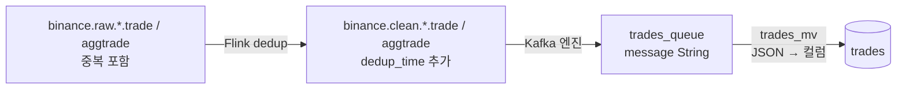
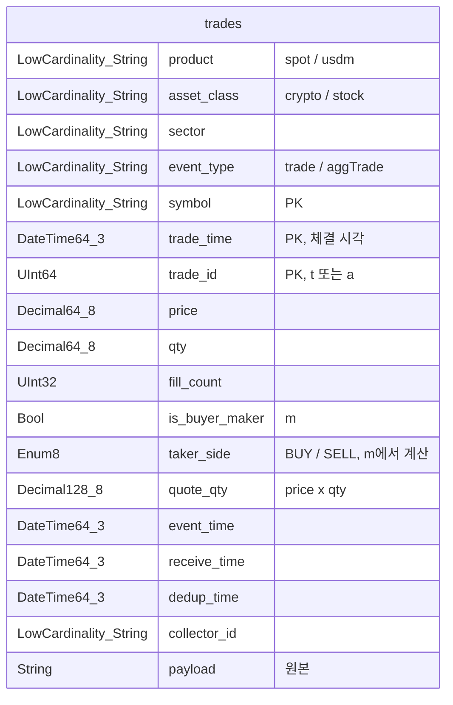

# trades

체결 한 건이 한 행인 테이블이다. 1분 봉(OHLCV), 거래대금, taker 매수 비율(매수 · 매도 압력), 고래 체결 리포트의 원천이 된다. DDL은 [trades.sql](trades.sql)에 있다.

| 항목 | 값 |
| --- | --- |
| 원천 토픽 | `binance.clean.spot.crypto.trade`, `binance.clean.usdm.crypto.aggtrade`, `binance.clean.usdm.stock.aggtrade` |
| 엔진 | `ReplacingMergeTree` |
| 파티션 | `toDate(trade_time)` (하루 단위) |
| 정렬 키 | `(product, symbol, trade_time, trade_id)` |
| 보존 | 30일 (`TTL`, 파티션째 지운다) |

## 데이터 흐름



- **clean 토픽에서 읽는다.** raw에는 Active-Active 두 pod가 보낸 같은 체결이 두 번씩 있다.
- `trades_queue`는 메시지를 JSON 문자열 그대로(`JSONAsString`) 받는다. spot `trade`와 usdm `aggTrade`는 필드가 조금 달라서(`t` / `a`), 큐에서 형식을 고정하지 않고 MV에서 `payload.e`를 보고 나눠 푼다.
- 토픽 3개를 큐 하나로 읽는다. 상품과 자산 종류는 envelope의 `product`, `asset_class`에 있다.

## 컬럼



| 컬럼 | 타입 | 원천 | 설명 |
| --- | --- | --- | --- |
| `product` | `LowCardinality(String)` | envelope `product` | `spot` / `usdm` |
| `asset_class` | `LowCardinality(String)` | envelope `asset_class` | `crypto` / `stock` |
| `sector` | `LowCardinality(String)` | envelope `sector` | 섹터 (`sov`, `semi` 등) |
| `event_type` | `LowCardinality(String)` | payload `e` | `trade` (spot) / `aggTrade` (usdm) |
| `symbol` | `LowCardinality(String)` | envelope `symbol` | `BTCUSDT`, `NVDAUSDT` |
| `trade_id` | `UInt64` | payload `t` 또는 `a` | 심볼 안에서 유일한 체결 ID |
| `price` | `Decimal64(8)` | payload `p` | 체결 가격 |
| `qty` | `Decimal64(8)` | payload `q` | 체결 수량 (base 자산) |
| `fill_count` | `UInt32` | trade: 1, aggTrade: `l - f + 1` | 이 행에 묶인 실제 체결 수 |
| `is_buyer_maker` | `Bool` | payload `m` | 매수자가 maker인가 |
| `taker_side` | `Enum8` | `is_buyer_maker`에서 계산 (`MATERIALIZED`) | taker가 매수자면 `BUY`, 매도자면 `SELL` |
| `quote_qty` | `Decimal128(8)` | `price × qty` (`MATERIALIZED`) | 체결 금액 (USDT 등) |
| `trade_time` | `DateTime64(3, 'UTC')` | payload `T` | 체결 시각. 리포트의 시간 축 |
| `event_time` | `DateTime64(3, 'UTC')` | envelope `event_time` (= payload `E`) | 거래소가 메시지를 보낸 시각 |
| `receive_time` | `DateTime64(3, 'UTC')` | envelope `receive_time` | 수집 앱이 받은 시각 |
| `dedup_time` | `DateTime64(3, 'UTC')` | clean 메시지 `dedup_time` | Flink dedup을 통과한 시각 |
| `collector_id` | `LowCardinality(String)` | envelope `collector_id` | 이 체결을 먼저 보낸 수집 pod |
| `payload` | `String` (ZSTD) | envelope `payload` | Binance 원본. 필드를 새로 꺼내야 할 때 다시 파싱한다 |

## raw 이벤트가 행이 되는 과정 (maker / taker)

### 1. maker와 taker

체결은 항상 두 주문이 만나서 생긴다.

| 구분 | 뜻 |
| --- | --- |
| **maker** | 호가창에 미리 걸어 두고 기다린 주문 (지정가) |
| **taker** | 걸려 있는 주문을 바로 가져가서 체결을 만든 주문 (시장가 등). 지금 가격에 사고팔겠다는 쪽이라 "공격적"이라고 부른다 |

Binance는 체결 메시지에 taker가 누구인지 직접 적지 않고, `m`(**isBuyerMaker**, 매수자가 maker인가)만 준다.

| `m` | 매수자 | 매도자 | 해석 | `taker_side` |
| --- | --- | --- | --- | --- |
| `true` | maker | **taker** | 걸려 있던 매수 주문에 누가 팔았다 → 공격적 매도 | `SELL` |
| `false` | **taker** | maker | 걸려 있던 매도 주문을 누가 사 갔다 → 공격적 매수 | `BUY` |

`m=true`가 "매수"처럼 읽혀서 헷갈리기 쉽다. 리포트 쿼리마다 뒤집어 쓰지 않도록 `taker_side`를 `MATERIALIZED` 컬럼으로 둔다. 원본 의미는 `is_buyer_maker`에 그대로 남긴다.

### 2. 예: spot trade 한 건

**raw 토픽** `binance.raw.spot.crypto.trade` (수집 pod 두 개가 같은 체결을 한 번씩 보낸다):

```json
{
  "source": "binance", "product": "spot", "asset_class": "crypto", "sector": "sov",
  "stream": "trade", "symbol": "BTCUSDT",
  "event_time": 1761700000123, "receive_time": 1761700000140, "collector_id": "spot-sov-7c9f-a",
  "payload": {
    "e": "trade", "E": 1761700000123, "s": "BTCUSDT",
    "t": 5123456789, "p": "113250.10000000", "q": "0.01200000",
    "T": 1761700000122, "m": true, "M": true
  }
}
```

**clean 토픽** `binance.clean.spot.crypto.trade`: Flink가 `(BTCUSDT, 5123456789)`를 처음 본 한 건만 남기고, `dedup_time`을 붙인다. payload는 그대로다.

```json
{ "...": "위와 같음", "dedup_time": 1761700000210 }
```

**trades 행:**

| 컬럼 | 값 | 어디서 |
| --- | --- | --- |
| `product` / `asset_class` / `sector` | `spot` / `crypto` / `sov` | envelope |
| `event_type` | `trade` | `payload.e` |
| `symbol` | `BTCUSDT` | envelope |
| `trade_id` | `5123456789` | `payload.t` |
| `price` / `qty` | `113250.1` / `0.012` | `payload.p` / `payload.q` (문자열 → Decimal) |
| `fill_count` | `1` | trade는 항상 1 |
| `is_buyer_maker` | `true` | `payload.m` |
| `taker_side` | `SELL` | `m=true` → 매도자가 taker |
| `quote_qty` | `1359.0012` | `113250.1 × 0.012` |
| `trade_time` | `2025-10-29 01:06:40.122` | `payload.T` (ms → DateTime64) |
| `event_time` / `receive_time` / `dedup_time` | `.123` / `.140` / `.210` | envelope, clean |
| `collector_id` | `spot-sov-7c9f-a` | envelope |
| `payload` | `{"e":"trade",...}` | 원본 |

→ "0.012 BTC를 **누가 시장가로 팔았다**"는 체결 한 건이 된다.

### 3. usdm aggTrade는 무엇이 다른가

USD-M은 `trade` 대신 `aggTrade`를 수집한다. **같은 taker 주문이 같은 가격에서 여러 maker 주문과 체결된 것을 한 메시지로 묶은 것**이다.

```json
"payload": {
  "e": "aggTrade", "E": 1761700000123, "s": "BTCUSDT",
  "a": 2987654321, "p": "113260.00", "q": "1.250",
  "f": 6100000001, "l": 6100000004, "T": 1761700000121, "m": false
}
```

| 필드 | trade (spot) | aggTrade (usdm) | trades 컬럼 |
| --- | --- | --- | --- |
| 체결 ID | `t` | `a` (묶음 ID) | `trade_id` |
| 묶인 체결 수 | 없음 (항상 1) | `l - f + 1` (위 예: 4) | `fill_count` |
| `m` | 같은 의미 | 같은 의미 | `is_buyer_maker` → `taker_side` |

- 위 aggTrade는 `m=false`라 `taker_side = BUY`다. "누가 1.25 BTC를 시장가로 사서 maker 매도 주문 4개를 한 번에 가져갔다"는 뜻이다.
- **수량 · 금액 합계는 trade와 aggTrade가 같다.** 묶어도 수량은 그대로 더해지기 때문이다. 그래서 taker 매수 비율은 spot과 usdm을 같은 식으로 비교할 수 있다.
- **행 수는 다르다.** "체결 건수"가 필요하면 `count()`가 아니라 `sum(fill_count)`를 쓴다.

## 리포트 쿼리 예

taker 매수 비율 (1분 단위). 0.5보다 크면 매수 압력, 작으면 매도 압력이다.

```sql
SELECT toStartOfMinute(trade_time)                       AS minute,
       sumIf(quote_qty, taker_side = 'BUY') / sum(quote_qty) AS taker_buy_ratio,
       sum(quote_qty)                                    AS volume_quote
FROM binance.trades
WHERE product = 'spot' AND symbol = 'BTCUSDT'
  AND trade_time >= now() - INTERVAL 1 HOUR
GROUP BY minute
ORDER BY minute;
```

1분 봉 (OHLCV):

```sql
SELECT toStartOfMinute(trade_time)           AS minute,
       argMin(price, (trade_time, trade_id)) AS open,
       max(price)                            AS high,
       min(price)                            AS low,
       argMax(price, (trade_time, trade_id)) AS close,
       sum(qty)                              AS volume
FROM binance.trades
WHERE product = 'usdm' AND symbol = 'NVDAUSDT'
GROUP BY minute
ORDER BY minute;
```

## 설계 결정

### 1. spot trade와 usdm aggTrade를 한 테이블에 둔다

- **고려 사항:** 필드가 조금 다르다 (`t` / `a`, `f` · `l`). 그래도 리포트는 둘을 나란히 비교한다 (spot vs usdm 매수 압력).
- **선택 옵션:** (A) 스트림마다 테이블 / (B) 한 테이블에 공통 컬럼으로 맞추기
- **선택:** B
- **이유:** 비교 쿼리에 `UNION`이 필요 없다. 다른 필드는 `trade_id`, `fill_count`로 맞추고, 원본은 `payload`에 남는다.
- **trade-off:** 행 하나의 의미가 다르다 (체결 1건 / 묶음 1건). 건수는 `sum(fill_count)`로 세야 한다.

### 2. `ReplacingMergeTree`로 한 번 더 중복을 거른다

- **고려 사항:** Flink sink와 ClickHouse Kafka 엔진이 모두 at-least-once라, 재시작하면 같은 체결이 다시 들어올 수 있다.
- **선택 옵션:** (A) `MergeTree` 그대로 / (B) `ReplacingMergeTree`
- **선택:** B. 정렬 키 `(product, symbol, trade_time, trade_id)`가 같은 행을 병합할 때 하나만 남긴다.
- **이유:** 같은 체결이면 `trade_time`도 같으므로, 시간 범위 조회에 맞춘 정렬 키로 중복도 같이 걸러진다.
- **trade-off:** 병합은 백그라운드에서 언제 될지 모른다. 정확한 건수가 필요하면 `FINAL`을 붙인다 (느려진다). 비율 리포트는 중복 몇 건에 거의 영향이 없어 `FINAL` 없이 쓴다.

### 3. 가격 · 수량은 `Decimal`, 시각은 UTC `DateTime64(3)`

- **고려 사항:** Binance는 가격 · 수량을 문자열로 준다 (`"113250.10000000"`). `Float64`로 바꾸면 합계에 오차가 생긴다.
- **선택:** `Decimal64(8)` (Binance 최대 소수 자릿수 8). 금액은 곱하면 자릿수가 늘어 `Decimal128(8)`.
- **trade-off:** `Float64`보다 계산이 조금 느리다.

### 4. 원본 payload를 같이 저장한다

- **고려 사항:** 나중에 다른 필드가 필요할 수 있다 (예: spot의 `M`).
- **선택:** `payload String CODEC(ZSTD(3))`
- **이유:** Kafka clean 토픽은 보존 기간이 지나면 지워지므로, 다시 만들 수 있는 곳이 여기뿐이다. 반복되는 JSON이라 ZSTD로 많이 줄어든다.
- **trade-off:** 디스크를 더 쓴다. 30일 TTL로 상한을 둔다.
