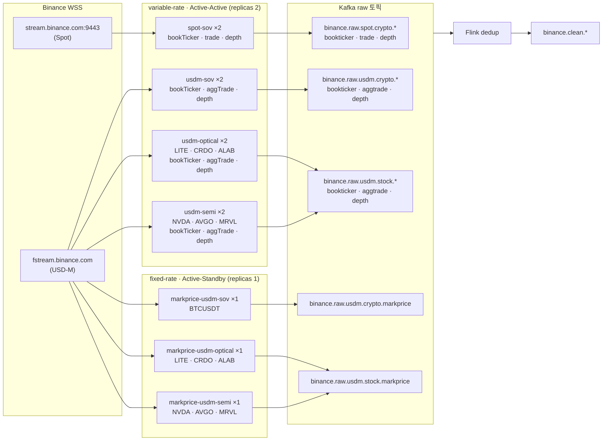

- **WebSocket Ingestion Framework 고려 사항**
- **Ingestion Application 구조 고려 사항**
    
    💡
    
    ### **Stream Ingestion Application 측면 고려사항**
    
    ---
    
## [고려 사항 1. 구조 설계]

> Ingestion Application 을 어떻게 구성할 것인가?
    

### 궁금했던 사항.

Stream 별로 application 을 만들어서 1:1 로 관리해야하나? `topic <-> Pod`**

 
- **선택 옵션**
  
    a. **`[Topic] <-> Pod`** 1:1 ⇒ 장애 격리 최대 / 운영부담 증가
    
    b. **`[product + symbol 별] <-> Pod`** ⇒ 한 프로세스가 여러 토픽을 다루므로 장애 시 그 커넥션에 물린 토픽 전부 같이 끊김.
    
    c. `모놀리식` ⇒ 수평 스케일링 불가

- 선택 : b.
        
    특정 심볼의 특정 wss 트래픽이 늘어난다면?
    같은 심볼의 다른 wss도 선형적으로 늘어날 것. ⇒ 수평 스케일링할 때, 괜찮을거 같음.
        
    예외 사항) 단, 특정 `markprice@1s` 와 같이 traffic이 일정한 것은 섹터별로 분리
        
    ex) 코인 섹터 / 주식 섹터
        
    - 고정 rate 그룹
    - 변동성 기반 그룹
    
## [고려 사항 2. Fail-Over 및 HA부분]
    
토픽을 어떤 구조로 받을거냐? (`Active-Active` or `Active-Standby`)

- **선택 옵션**

    1. **`Active-Standby`** (replicas=1, 재시작 기반) ⇒ 가장 단순, 중복 원천 차단 / 재시작 동안 다운타임 발생

    2. **`Active-Standby`** (핫스탠바이 + leader election, K8s Lease·Postgres advisory lock) 
   
        ⇒ 다운타임 최소화, 중복 없음 / 구현 복잡도 추가
        
        ⇒ 하지만 어느 정도의 공백을 허용한다면? 지장없을듯 함.

    3. **`Active-Active`** ⇒ 페일오버 공백 거의 0 / **중복 발생이 설계상 필연** → 3번 문제를 반드시 풀어야 함, 인프라 비용도 배

- **선택 :**
  
    3. 학습 목적으로 `Active-Active` 채택. 파드 수(2개) / 심볼 수(1~2개)를 최소로 유지해 리소스 부담 제거

- ps. **중복 제거는 어떻게 할 것인가..?**

    - 중복 판별 키 : trade_id

    - 어디서 제거할 것인가?

        a. kafka 앞에 => redis 고려

        b. kafka 뒤에 => flink 에서 중복 제거

- 선택 : a.

    - 왜 Kafka 앞인가
        - 중복을 발생 지점에서 차단 → 하류 소비자 전체가 중복을 신경 쓰지 않아도 됨
        - 
    - 왜 Redis인가 (vs DB unique constraint)
        - 인메모리: 모든 메시지가 거치는 경로라 sub-ms 지연 필요
        - SET NX EX: 확인+기록을 원자적으로 처리 → 파드 간 경합 안전
        - TTL: dedup 키는 수십 초만 유효하면 됨 → 자동 만료, 메모리 일정 (~12MB 수준)
          TTL은 두 파드 간 동일 이벤트 도착 시차보다 넉넉하게 (30~60s)

    - redis 부하 측정..?

      - 

- b.가 아닌 이유

    ```
    단일 소비자라면 Flink 잡 안에서 끝낼 수 있지만, 소비자 확장성을 고려하면 dedup 결과를 Kafka 토픽으로 다시 공유해야 해서 Kafka를 한 번 더 거치고 그만큼 지연이 늘어납니다. 수집단에서 Redis로 막으면 raw 토픽 자체가 이미 중복 없는 상태라서 이 추가 단계가 필요 없습니다."
    ```

- 이후..? 펜싱 구조 고려


## [고려 사항 3. HA 부분]

`Active-Active` 라면 중복 토픽 메시징은 어떻게 중복 처리할거냐..?
    
`Acitve-Active` 구조로 페일오버 공백 처리는 해결됨.

하지만, 모든 파드가 동일한 외부 WebSocket 스트림을 동시에 수신하여 카프카로 전송하기에, 동일한 데이터가 카프카 토픽에 종복 적재되는 문제

- **선택 옵션**
    
    1. Consumer 단 Redis 기반 Deduplication (In Memory 단 필터링)
    
    2. Stream Processing Engine (Apache Flink / Kafka Streams)
    
    3. DB
        - DB Unique Constraint
    
    4. ClickHouse
        - ClickHouse ReplacingMergeTree 엔진 활용
        - ClickHouse 네이티브 Kafka Engine + `Replicated_deduplication_window`
    
- **선택 :**


## [Ingestion Pod 구성도]

[0TickerInfoTable.md](../../APIdocs/0TickerInfoTable.md)의 수집 심볼을 기준으로, 위 고려 사항을 적용했을 때 뜨는 pod 구성이다. 토픽 설계는 [topic/plan.md](../topic/plan.md) 참고.

### 수집 대상

| 자산 | product | 심볼 |
| --- | --- | --- |
| crypto | spot | BTCUSDT |
| crypto | usdm | BTCUSDT |
| stock (optical) | usdm | LITEUSDT, CRDOUSDT, ALABUSDT |
| stock (semi) | usdm | NVDAUSDT, AVGOUSDT, MRVLUSDT |

### pod 그룹 규칙

| 그룹 | 스트림 | 묶는 단위 | HA | replicas | pod 이름 규칙 |
| --- | --- | --- | --- | --- | --- |
| variable-rate | bookTicker, trade(aggTrade), depth | 섹터 (crypto `sov`는 지금 BTC 하나) | Active-Active | 2 | `<product>-<섹터>` |
| fixed-rate | markPrice@1s | 섹터 | Active-Standby | 1 | `markprice-<product>-<섹터>` |

- variable-rate pod 하나는 **스트림 종류마다 소켓 1개씩, 총 3개**를 연다. 섹터 pod는 같은 스트림의 심볼들을 combined stream 하나로 묶는다.
- fixed-rate pod는 섹터에 속한 심볼의 `<symbol>@markPrice@1s`만 combined로 구독한다 (`!markPrice@arr` 전체 구독 후 필터링하지 않음).
- stock은 기초 시장 장외 시간에 트래픽이 거의 없어 심볼별이 아니라 섹터별로 묶는다.
- pod 이름은 crypto와 stock 모두 섹터로 짓고 자산 종류는 넣지 않는다 (`usdm-optical`, `markprice-usdm-sov`). 자산 종류는 pod label `asset-class`와 토픽 이름에 있다. 그래서 **섹터 값은 자산 종류끼리 겹치지 않게** 정한다 (crypto 섹터 값은 [cryptoSectorREADME.md](../../APIdocs/cryptoSectorREADME.md)). 로그 라벨 `<product>-<섹터>-<stream>`도 pod 이름과 같은 앞부분을 쓴다. crypto는 심볼 하나의 트래픽이 크므로, 같은 섹터에 심볼을 추가할 때 한 pod로 묶을지 섹터 안에서 pod를 나눌지 그때 다시 판단한다.
- pod template에는 `product`, `asset-class`, `sector` label을 붙여 `kubectl get pods -L sector`, `-l sector=optical`로 조회한다.

### 구성도



### pod 하나의 내부 (usdm-semi 예시)

```text
┌──────────────────────── pod: usdm-semi-8c5d7e9f1-g5h6i ────────────────────────┐
│                                                                                      │
│  socket 1  /public/stream?streams=nvdausdt@bookTicker/avgousdt@bookTicker/mrvlusdt@bookTicker
│     └──> parser(bookTicker) ──> binance.raw.usdm.stock.bookticker                    │
│                                                                                      │
│  socket 2  /market/stream?streams=nvdausdt@aggTrade/avgousdt@aggTrade/mrvlusdt@aggTrade
│     └──> parser(aggTrade)   ──> binance.raw.usdm.stock.aggtrade                      │
│                                                                                      │
│  socket 3  /public/stream?streams=nvdausdt@depth@100ms/avgousdt@depth@100ms/mrvlusdt@depth@100ms
│     └──> parser(depth)      ──> binance.raw.usdm.stock.depth                         │
│                                                                                      │
│  envelope: product=usdm, asset_class=stock, sector=semi, collector_id=$HOSTNAME      │
└──────────────────────────────────────────────────────────────────────────────────────┘
   × 2 (Active-Active, 같은 이벤트를 두 pod가 모두 발행 → Flink에서 dedup)
```

### 전체 pod 목록 (총 11개)

| Deployment | 그룹 | replicas | 소켓 수 | 쓰는 토픽 |
| --- | --- | --- | --- | --- |
| `spot-sov` | variable-rate | 2 | 3 | `binance.raw.spot.crypto.{bookticker,trade,depth}` |
| `usdm-sov` | variable-rate | 2 | 3 | `binance.raw.usdm.crypto.{bookticker,aggtrade,depth}` |
| `usdm-optical` | variable-rate | 2 | 3 | `binance.raw.usdm.stock.{bookticker,aggtrade,depth}` |
| `usdm-semi` | variable-rate | 2 | 3 | `binance.raw.usdm.stock.{bookticker,aggtrade,depth}` |
| `markprice-usdm-sov` | fixed-rate | 1 | 1 | `binance.raw.usdm.crypto.markprice` |
| `markprice-usdm-optical` | fixed-rate | 1 | 1 | `binance.raw.usdm.stock.markprice` |
| `markprice-usdm-semi` | fixed-rate | 1 | 1 | `binance.raw.usdm.stock.markprice` |

### pod별 구독 웹소켓

USD-M은 스트림 종류에 따라 경로 접두어가 다르다. 접두어를 틀리면 연결은 되지만 메시지가 오지 않는다.

| product | 경로 | 스트림 |
| --- | --- | --- |
| Spot | `wss://stream.binance.com:9443/ws/` (단일), `/stream?streams=` (combined) | bookTicker, trade, depth |
| USD-M | `wss://fstream.binance.com/public/...` | bookTicker, depth |
| USD-M | `wss://fstream.binance.com/market/...` | aggTrade, markPrice |

#### variable-rate

```text
spot-sov  (×2)
 ├─ socket 1  wss://stream.binance.com:9443/ws/btcusdt@bookTicker
 ├─ socket 2  wss://stream.binance.com:9443/ws/btcusdt@trade
 └─ socket 3  wss://stream.binance.com:9443/ws/btcusdt@depth@100ms

usdm-sov  (×2)
 ├─ socket 1  wss://fstream.binance.com/public/ws/btcusdt@bookTicker
 ├─ socket 2  wss://fstream.binance.com/market/ws/btcusdt@aggTrade
 └─ socket 3  wss://fstream.binance.com/public/ws/btcusdt@depth@100ms

usdm-optical  (×2)
 ├─ socket 1  wss://fstream.binance.com/public/stream?streams=liteusdt@bookTicker/crdousdt@bookTicker/alabusdt@bookTicker
 ├─ socket 2  wss://fstream.binance.com/market/stream?streams=liteusdt@aggTrade/crdousdt@aggTrade/alabusdt@aggTrade
 └─ socket 3  wss://fstream.binance.com/public/stream?streams=liteusdt@depth@100ms/crdousdt@depth@100ms/alabusdt@depth@100ms

usdm-semi  (×2)
 ├─ socket 1  wss://fstream.binance.com/public/stream?streams=nvdausdt@bookTicker/avgousdt@bookTicker/mrvlusdt@bookTicker
 ├─ socket 2  wss://fstream.binance.com/market/stream?streams=nvdausdt@aggTrade/avgousdt@aggTrade/mrvlusdt@aggTrade
 └─ socket 3  wss://fstream.binance.com/public/stream?streams=nvdausdt@depth@100ms/avgousdt@depth@100ms/mrvlusdt@depth@100ms
```

#### fixed-rate

```text
markprice-usdm-sov  (×1)
 └─ socket 1  wss://fstream.binance.com/market/ws/btcusdt@markPrice@1s

markprice-usdm-optical  (×1)
 └─ socket 1  wss://fstream.binance.com/market/stream?streams=liteusdt@markPrice@1s/crdousdt@markPrice@1s/alabusdt@markPrice@1s

markprice-usdm-semi  (×1)
 └─ socket 1  wss://fstream.binance.com/market/stream?streams=nvdausdt@markPrice@1s/avgousdt@markPrice@1s/mrvlusdt@markPrice@1s
```

- 심볼이 하나면 `/ws/<stream>` (단일), 여러 개면 `/stream?streams=a/b/c` (combined)를 쓴다. combined는 메시지가 `{"stream": "...", "data": {...}}`로 감싸져 오므로, `stream` 필드로 심볼을 구분해 파싱한다.
- 실제 URL에는 줄바꿈 없이 한 줄로 쓴다.
- 소켓 수 합계: variable-rate 4종 × 3소켓 × 2 replicas = 24, fixed-rate 3종 × 1소켓 × 1 = 3, 총 **27개 연결**.

```text
$ kubectl get pods -n ingestion
spot-sov-6f8d9c7b5-x2k4p
spot-sov-6f8d9c7b5-m8q1z
usdm-sov-5b7c8d9f6-p3n7w
usdm-sov-5b7c8d9f6-k9r2t
usdm-optical-7d4f6b8c9-a1b2c
usdm-optical-7d4f6b8c9-d3e4f
usdm-semi-8c5d7e9f1-g5h6i
usdm-semi-8c5d7e9f1-j7k8l
markprice-usdm-sov-4a6b8c2d3-m9n0p
markprice-usdm-optical-9e1f3a5b7-q1r2s
markprice-usdm-semi-2b4d6f8a1-t3u4v
```

pod 이름 끝의 해시는 Kubernetes가 붙이는 랜덤 값이다. 그룹은 이름이 아니라 label(`rate-group: variable | fixed`)로 구분한다.
