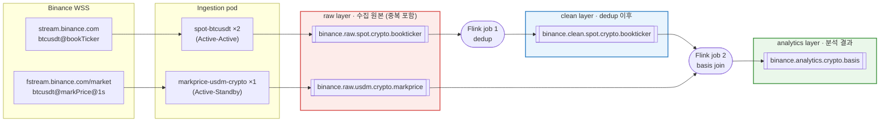

# Insight 1. Spot-Futures Basis — 토픽 흐름

Insight 1-1(Spot-Futures Basis)을 계산하기 위해 데이터가 어떤 토픽을 거쳐 흐르는지 정리한다. 토픽 이름 규칙과 공통 설정은 [plan.md](plan.md), pod 구성은 [ingestion/plan.md](../ingestion/plan.md), 분석 로직(z-score, 디바운스)은 [1_1_plan.md](../../Insights/1.spot_futures_basis/1_1_plan.md)를 따른다.

```text
Basis = Mark Price (USD-M) − Spot Mid Price
Spot Mid Price = (best bid + best ask) / 2
```

## [전체 흐름]



```text
WSS(Spot)  ─> spot-btcusdt ×2 ─> binance.raw.spot.crypto.bookticker
                                        │
                                 Flink job 1: dedup (키: u)
                                        ▼
                                 binance.clean.spot.crypto.bookticker ─┐
                                                                        │ key = BTCUSDT
WSS(USD-M) ─> markprice-usdm-crypto ×1 ─> binance.raw.usdm.crypto.markprice ─┤
                                                                        ▼
                                                    Flink job 2: basis join
                                                                        ▼
                                                    binance.analytics.crypto.basis
```

- **Spot은 clean을 거친다.** `spot-btcusdt`는 Active-Active라 raw에 같은 이벤트가 두 번 들어온다.
- **markPrice는 raw를 그대로 쓴다.** fixed-rate pod는 Active-Standby라 중복이 없어서 dedup 단계가 없다.

## [사용 토픽]

| 토픽 | 쓰는 쪽 | 읽는 쪽 | 키 | 파티션 | 보존 | yaml 위치 |
| --- | --- | --- | --- | --- | --- | --- |
| `binance.raw.spot.crypto.bookticker` | spot-btcusdt pod | Flink job 1 | `BTCUSDT` | 3 | 24h | `binance/raw/crypto/` |
| `binance.clean.spot.crypto.bookticker` | Flink job 1 | Flink job 2 | `BTCUSDT` | 3 | 24h | `binance/clean/crypto/` |
| `binance.raw.usdm.crypto.markprice` | markprice-usdm-crypto pod | Flink job 2 | `BTCUSDT` | 3 | 3d | `binance/raw/crypto/` |
| `binance.analytics.crypto.basis` | Flink job 2 | 대시보드, 알림 | `BTCUSDT` | 3 | 7d | `binance/analytics/crypto/` |

yaml 위치는 [Infra/Kafka/Kafka-Topic/](../../Infra/Kafka/Kafka-Topic/) 기준이다. 4개 토픽 모두 공통으로 아래 설정을 쓴다.

| 설정 | 값 | 이유 |
| --- | --- | --- |
| `replicas` | 3 | 브로커 3대에 모두 복제 |
| `min.insync.replicas` | 2 | 브로커 1대 장애까지 쓰기 유지 |
| `compression.type` | `zstd` | JSON 압축 |
| `message.timestamp.type` | `LogAppendTime` | 브로커 적재 시각을 레코드 timestamp로 기록 (지연 측정용) |

## [조인 조건: co-partitioning]

job 2에서 두 토픽을 같은 키로 조인하려면 아래 조건을 모두 지켜야 한다.

| 조건 | 설계 |
| --- | --- |
| 두 토픽의 키 값이 같음 | 둘 다 심볼(`BTCUSDT`). product는 토픽 이름에 있으므로 키에 넣지 않는다 |
| 두 토픽의 파티션 수가 같음 | 둘 다 3. **clean 토픽도 반드시 3으로 만든다** |
| 같은 partitioner | 기본 partitioner 사용 |

> 기존 [1_1_plan.md §4.5](../../Insights/1.spot_futures_basis/1_1_plan.md)는 키를 `spot:BTCUSDT`, `usdm:BTCUSDT`로 다르게 잡아 그대로는 조인이 안 된다 (re-key 필요). 이 문서의 설계로 대체한다.

## [Flink job 1: dedup]

| 항목 | 값 |
| --- | --- |
| 입력 | `binance.raw.spot.crypto.bookticker` |
| 출력 | `binance.clean.spot.crypto.bookticker` |
| dedup 키 | `u` (order book update id) |
| 방식 | `keyBy(u)` → `ValueState<Boolean>`로 처음 본 키만 통과 |
| state TTL | 1분 (두 pod 간 도착 시차보다 넉넉하게) |
| envelope | 그대로 넘기고 `dedup_time`만 추가 |

## [Flink job 2: basis join]

| 항목 | 값 |
| --- | --- |
| 입력 | `binance.clean.spot.crypto.bookticker`, `binance.raw.usdm.crypto.markprice` |
| 출력 | `binance.analytics.crypto.basis` |
| 방식 | 두 스트림을 `keyBy(symbol)` 후 `connect` → `KeyedCoProcessFunction` |
| 출력 빈도 | markPrice 1건당 1건 (초당 1건) |

**윈도우 조인을 쓰지 않는 이유:** bookTicker는 초당 수십~수백 건, markPrice는 1건이다. 윈도우 조인은 윈도우 안의 모든 조합을 출력하므로 10초 윈도우면 결과가 수천 건이 된다. 필요한 것은 "markPrice가 왔을 때 그 순간의 최신 Spot mid"이므로, Spot은 최신값만 state에 두고 markPrice가 올 때 조회한다.

```java
spotMid.keyBy(SpotMid::symbol)
    .connect(markPrice.keyBy(MarkPrice::symbol))
    .process(new KeyedCoProcessFunction<String, SpotMid, MarkPrice, Basis>() {
        ValueState<SpotMid> latestSpot;   // 심볼별 최신 Spot mid

        // Spot 이벤트: 최신값만 갱신, 출력 없음
        public void processElement1(SpotMid s, Context ctx, Collector<Basis> out) throws Exception {
            latestSpot.update(s);
        }

        // markPrice 이벤트(1초마다): 최신 Spot과 계산해서 출력
        public void processElement2(MarkPrice m, Context ctx, Collector<Basis> out) throws Exception {
            SpotMid s = latestSpot.value();
            if (s != null && m.eventTime() - s.eventTime() < 2000) {   // Spot이 2초 이상 오래됐으면 버림
                out.collect(Basis.of(m, s));
            }
        }
    })
    .sinkTo(analyticsSink);   // binance.analytics.crypto.basis
```

- **신선도 체크:** Spot 연결이 끊기면 state에 오래된 값이 남는다. 두 이벤트의 `event_time` 차이가 2초를 넘으면 버린다.
- **z-score, 연속 윈도우 카운트:** [1_1_plan.md §3](../../Insights/1.spot_futures_basis/1_1_plan.md)의 로직을 이 job의 출력 위에서 계산한다.

### 출력 메시지 (`binance.analytics.crypto.basis`)

```json
{
  "symbol": "BTCUSDT",
  "event_time": 1729400000000,
  "mark_price": "78853.70",
  "spot_mid": "78760.565",
  "basis": "93.135",
  "funding_rate": "0.00008778",
  "spot_event_time": 1729399999650,
  "receive_time": 1729400000012,
  "z_score": 2.4,
  "alert": false
}
```

## [지연 측정]

단계마다 타임스탬프를 남기고, envelope의 `receive_time`을 끝까지 유지한다.

| 시점 | 값 | 기록 주체 |
| --- | --- | --- |
| ① 거래소 이벤트 발생 | `E` (payload) | Binance |
| ② collector 수신 | `receive_time` | collector |
| ③ raw 토픽 적재 | raw 레코드 timestamp | 브로커 (`LogAppendTime`) |
| ④ dedup 처리 | `dedup_time` | Flink job 1 |
| ⑤ clean 토픽 적재 | clean 레코드 timestamp | 브로커 (`LogAppendTime`) |
| ⑥ basis 출력 적재 | analytics 레코드 timestamp | 브로커 (`LogAppendTime`) |

```text
거래소 → collector   = ② − ①   (참고용: Binance 시계와 로컬 시계 차이가 섞임)
collector → raw      = ③ − ②
raw → dedup → clean  = ⑤ − ③
clean → basis        = ⑥ − ⑤
end-to-end           = ⑥ − ②
```

- ②부터는 모두 같은 kind 클러스터(같은 호스트) 시계라 정확하다. 파이프라인 성능은 ② 기준으로 본다.
- **Flink exactly-once 주의:** `KafkaSink`를 `EXACTLY_ONCE`로 쓰면 체크포인트가 끝나야 커밋되므로, `read_committed` 소비자에게는 체크포인트 간격만큼 늦게 보인다. `⑤ − ③`이 체크포인트 간격과 비슷하게 나오면 이 원인이다. 실시간 basis에는 `AT_LEAST_ONCE`를 쓰거나 체크포인트 간격을 1~2초로 줄인다.

## [남은 과제]

- **clean 토픽 경유 여부:** dedup과 join을 한 Flink job으로 합치면 Kafka를 한 번 덜 거쳐 지연이 줄어든다. 대신 clean 토픽을 다른 분석에서 재사용할 수 없다. 현재는 단계별 지연 측정과 재사용을 위해 job 2개로 둔다.
- **collector 수정:** 현재 POC의 [RawEventPublisher.java](../../datasource-ingestion/collector/src/main/java/com/ingestion/kafka/RawEventPublisher.java)는 `binance.raw.bookticker`(키 `spot:BTCUSDT`), `binance.raw.markprice`(키 `usdm:BTCUSDT`)로 로그만 남긴다. 토픽 이름과 키를 이 문서 기준으로 바꾸고 envelope에 `receive_time`을 넣어야 한다.
- **1_1_plan.md 정리:** §2(KStream-KStream 윈도우 조인)와 §4.5(토픽, 키)를 이 문서 기준으로 고친다.
- **analytics 토픽 이름:** basis는 Spot과 USD-M을 함께 쓰는 결과라 이름에 product를 넣지 않았다 (`binance.analytics.crypto.basis`). 이 예외를 [plan.md](plan.md)의 이름 규칙에도 적어 둔다.
