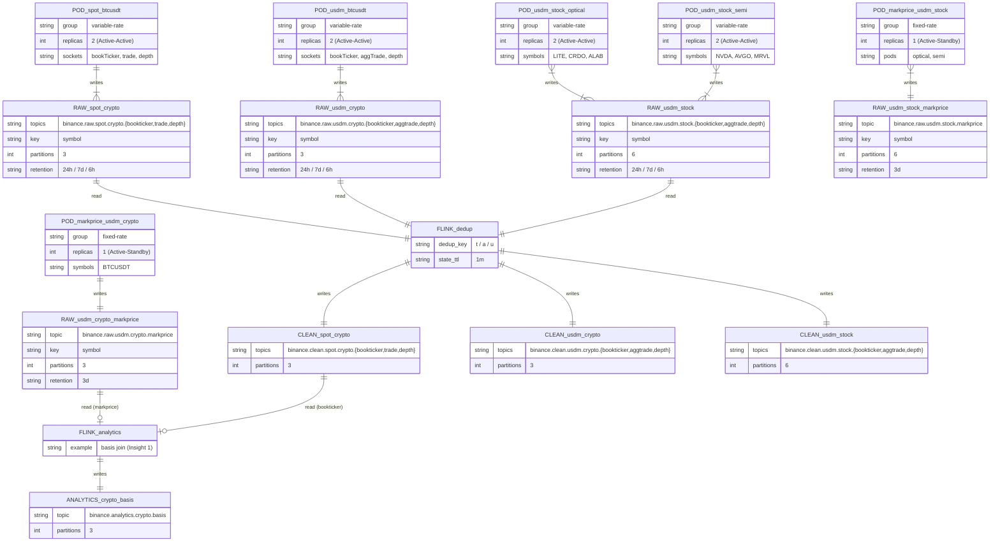

# Kafka Topic 설계

Ingestion pod가 Binance WSS에서 받은 이벤트를 어떤 토픽에 넣을지 정리한다. pod 구성은 [ingestion/plan.md](../ingestion/plan.md), 수집 심볼은 [0TickerInfoTable.md](../../docs/symbols/0TickerInfoTable.md)를 기준으로 한다.

## [고려 사항 1. 토픽을 나누는 단위]

> 웹소켓 하나에 토픽 하나로 설계해야 하나?

- **선택 옵션**

    a. **웹소켓 1개 = 토픽 1개** ⇒ 수집 구조와 1:1이라 직관적 / pod 구성이 바뀌면 토픽도 바뀜, 같은 데이터가 여러 토픽에 흩어짐

    b. **스트림 종류별 토픽** (`trade`, `bookticker` 등) ⇒ 토픽 수 최소 / Spot과 USD-M의 스키마가 섞임

    c. **product × 자산종류 × 스트림 종류별 토픽** ⇒ 토픽 하나에 스키마 하나 / 토픽 수 증가

    d. **심볼별 토픽** (`...nvdausdt`) ⇒ 소비자 필터 불필요 / 심볼마다 토픽 생성, 섹터·교차 분석이 복잡

- **선택 : c.**

    - 웹소켓은 **수집 단위**, 토픽은 **데이터 종류 단위**다. 둘은 따로 정한다.
    - 같은 토픽에 넣어도 되는지는 아래 세 가지가 모두 같은지로 판단한다.
        1. **스키마가 같은가** — 한 토픽에는 한 가지 구조만 넣는다. 같은 bookTicker라도 Spot에는 이벤트 타입(`e`) 필드가 없어서 USD-M과 스키마가 다르다.
        2. **보존 정책이 같은가** — retention은 토픽 단위로만 설정할 수 있다.
        3. **읽는 소비자가 같은가** — 같은 분석 로직으로 처리하는 데이터인가.

## [고려 사항 2. crypto와 stock을 토픽으로 나눌 것인가]

USD-M의 BTC 선물과 주식 선물(TradFi Perpetual)은 스키마가 같아서 한 토픽에 넣을 수도 있다.

- **선택 옵션**

    a. **같은 토픽 + envelope 필드로 구분** ⇒ 토픽 수 최소, 교차 분석 쉬움 / 각 소비자가 필요 없는 데이터까지 읽고 걸러야 함

    b. **토픽 분리** ⇒ 소비자·보존·파티션을 따로 관리 / 토픽 수 증가, 교차 분석 시 토픽 2개를 합쳐야 함

- **선택 : b.**

    - 읽는 소비자가 실제로 다르다.

        | 분석 | 읽는 데이터 |
        | --- | --- |
        | Insight 1-1 Spot-Futures Basis | BTC만 (Spot, USD-M) |
        | Insight 10 TradFi 장외 괴리 | 주식만 |

    - 트래픽 성격이 다르다. BTC는 24시간 내내 많고, 주식은 기초 시장의 장외 시간에 거의 조용하다.
    - 주식 분석 소비자가 밀려도(lag) 코인 쪽에 영향이 없다.
    - pod도 이미 `usdm-sov`(crypto)와 `usdm-optical`·`usdm-semi`(stock)로 나뉘어 있어 수집 구조와 맞는다.
    - 교차 분석(BTC와 NVDA 상관관계 등)은 Kafka Streams `merge()`, Flink union으로 토픽 두 개를 합쳐 읽는다.

- **섹터는 토픽으로 나누지 않는다.** optical, semi는 같은 stock 토픽에 넣고 envelope의 `sector` 필드로 구분한다. 섹터마다 토픽을 만들면 섹터가 늘 때마다 토픽도 늘어 옵션 d(심볼별 토픽)와 같은 문제가 생긴다.

## [고려 사항 3. 토픽 이름 규칙]

```text
binance.<단계>.<product>.<자산종류>.<스트림>

단계     : raw (수집 원본, 중복 포함) / clean (dedup 이후) / analytics (분석 결과)
product  : spot / usdm
자산종류 : crypto / stock
스트림   : bookticker / trade / aggtrade / depth / markprice
```

- Spot에는 주식이 없지만, 규칙을 통일하기 위해 `crypto`를 넣는다.
- 이름은 소문자, 숫자, `.`만 쓴다. 대문자나 `_`를 쓰지 않으면 Strimzi `KafkaTopic`의 `metadata.name`을 토픽 이름과 똑같이 쓸 수 있다.

## [고려 사항 4. crypto 심볼에도 sector를 붙일 것인가]

> envelope의 `sector`는 stock 섹터(optical, semi)를 구분하려고 만들었다. crypto 이벤트에는 무엇을 넣어야 하나?

- **선택 옵션**

    a. **`null`** ⇒ 아직 crypto 섹터 수집이 없으니 비워 둠 / 소비자마다 null 처리가 필요, crypto 섹터를 추가할 때 기준을 그때 새로 정해야 함

    b. **`coin` 같은 고정값** ⇒ 모든 이벤트에 값이 있음 / `asset_class=crypto`와 같은 정보를 반복, 나중에 진짜 섹터(l1, meme 등)를 넣으면 축이 다른 값이 섞임

    c. **코인의 역할로 분류** (`sov`, `l1`, `meme` 등) ⇒ stock과 같은 "섹터 = 역할" 축으로 통일 / 분류 표준이 없어 기준을 직접 관리해야 함

- **선택 : c.**

    - `sector`의 의미가 자산 종류와 상관없이 **"이 종목이 무슨 역할을 하는가"** 하나로 통일된다. Flink에서 `GROUP BY sector`를 해도 같은 축의 값만 나온다.
    - 분류 기준을 지금 [cryptoSectorREADME.md](../../docs/symbols/cryptoSectorREADME.md)로 정해 두면, crypto 섹터 pod(`l1` 바스켓 등)를 추가할 때 envelope 규칙을 다시 바꿀 필요가 없다.
    - 값은 ConfigMap의 `binance.subscription.sector`로만 정해지므로 수집 앱 코드는 바뀌지 않는다. 현재 영향 범위는 BTC pod 3개의 설정 한 줄씩이다. pod 이름도 crypto와 stock 모두 `<product>-<섹터>` 규칙으로 맞췄다 (`spot-btcusdt` → `spot-sov`, `usdm-stock-optical` → `usdm-optical` 등, [ingestion/plan.md](../ingestion/plan.md) pod 그룹 규칙).
    - BTC는 `sov`다.

- **감수하는 trade-off**
    - **분류 기준을 직접 관리해야 한다.** 코인 분류에는 표준이 없고 한 코인이 여러 분류에 걸친다. "가격을 주로 움직이는 이유 하나를 고른다"는 규칙을 cryptoSectorREADME.md에 두고, 추가할 때 CoinGecko·CoinMarketCap 카테고리로 확인한다.
    - **기존 raw 데이터와 값이 다르다.** 이 결정 전에 쌓인 crypto 이벤트는 `sector: null`이다. 재처리할 때는 `COALESCE(sector, 'sov')`처럼 symbol 기준으로 채운다 (지금은 BTCUSDT 하나뿐).
    - **단일 심볼 pod에서는 정보량이 적다.** BTC 하나만 받는 pod는 sector가 심볼과 1:1이다. 값어치는 crypto 섹터 pod가 생길 때 나온다.

## [토픽 목록]

### raw 토픽 (11개)

| 토픽 | 쓰는 pod | 키 | 파티션 | 보존 |
| --- | --- | --- | --- | --- |
| `binance.raw.spot.crypto.bookticker` | spot-sov | 심볼 | 3 | 24h |
| `binance.raw.spot.crypto.trade` | spot-sov | 심볼 | 3 | 7d |
| `binance.raw.spot.crypto.depth` | spot-sov | 심볼 | 3 | 6h |
| `binance.raw.usdm.crypto.bookticker` | usdm-sov | 심볼 | 3 | 24h |
| `binance.raw.usdm.crypto.aggtrade` | usdm-sov | 심볼 | 3 | 7d |
| `binance.raw.usdm.crypto.depth` | usdm-sov | 심볼 | 3 | 6h |
| `binance.raw.usdm.crypto.markprice` | markprice-usdm-sov | 심볼 | 3 | 3d |
| `binance.raw.usdm.stock.bookticker` | usdm-optical, usdm-semi | 심볼 | 6 | 24h |
| `binance.raw.usdm.stock.aggtrade` | usdm-optical, usdm-semi | 심볼 | 6 | 7d |
| `binance.raw.usdm.stock.depth` | usdm-optical, usdm-semi | 심볼 | 6 | 6h |
| `binance.raw.usdm.stock.markprice` | markprice-usdm-optical, markprice-usdm-semi | 심볼 | 6 | 3d |

- Spot은 `trade`, USD-M은 `aggTrade`를 수집한다.
- 보존 기간 기준: depth와 bookTicker는 양이 많고 시간이 지나면 가치가 떨어져 짧게, trade는 원본 기록 가치가 커서 길게 잡는다.

### pod와 토픽의 관계 (usdm 예시)

```text
usdm-optical  socket(bookTicker) ──┐
usdm-semi     socket(bookTicker) ──┴──> binance.raw.usdm.stock.bookticker

usdm-optical  socket(aggTrade)   ──┐
usdm-semi     socket(aggTrade)   ──┴──> binance.raw.usdm.stock.aggtrade

usdm-sov      socket(aggTrade)   ─────> binance.raw.usdm.crypto.aggtrade
```

pod 하나의 소켓 3개는 각각 다른 토픽에 쓰고, 같은 종류의 소켓은 pod가 달라도 같은 토픽에 쓴다.

### clean 토픽

variable-rate pod는 Active-Active라서 raw 토픽에 같은 이벤트가 두 번 들어온다. Flink가 dedup한 결과를 clean 토픽에 쓰고, 분석 소비자는 clean 토픽만 읽는다.

```text
binance.raw.usdm.stock.aggtrade ──Flink dedup (keyBy trade id, state TTL)──> binance.clean.usdm.stock.aggtrade
```

| raw | dedup 키 | clean |
| --- | --- | --- |
| `*.trade` | `t` (trade id) | `binance.clean.<product>.<자산종류>.trade` |
| `*.aggtrade` | `a` (aggregate trade id) | `binance.clean.usdm.<자산종류>.aggtrade` |
| `*.bookticker` | `u` (update id) | `binance.clean.<product>.<자산종류>.bookticker` |
| `*.depth` | `u` (final update id) | `binance.clean.<product>.<자산종류>.depth` |
| `*.markprice` | 해당 없음 | clean 없음 (fixed-rate는 Active-Standby라 중복이 생기지 않음) |

## [토픽 관계도 (ERD)]

pod, 토픽, Flink job을 엔티티로 보고 "누가 어느 토픽에 쓰고 읽는지"를 관계로 그린다. 토픽은 같은 product × 자산종류 묶음으로 표시하고, 속성에 포함된 스트림과 설정을 적었다.



**읽는 법**
- `||--|{` : 왼쪽 1개가 오른쪽 여러 개와 연결된다. 예: `spot-sov` pod 하나가 raw 토픽 3개(bookticker, trade, depth)에 쓴다.
- `}|--|{` : 여러 pod가 같은 토픽 묶음에 함께 쓴다. 예: optical, semi pod가 모두 `binance.raw.usdm.stock.*`에 쓴다.
- markprice 토픽은 Active-Standby라 중복이 없어서 `FLINK_dedup`을 거치지 않고 바로 분석에 쓰인다.
- `FLINK_analytics`는 현재 Insight 1(basis)만 있다. 상세 흐름은 [insight_1_plan.md](insight_1_plan.md) 참고.

## [키와 파티션]

- **키:** 심볼 (`BTCUSDT`, `NVDAUSDT`). product와 자산종류는 토픽 이름에 있으므로 키에 넣지 않는다.
- 키가 같으면 같은 파티션으로 가므로, 한 심볼의 이벤트는 항상 순서대로 쌓인다.
- **파티션 수:** 소비자 병렬도의 상한이다. 키가 심볼이라 심볼 수보다 파티션이 많으면 일부 파티션은 쓰이지 않는다.
    - crypto: 지금은 BTCUSDT 하나라 1개로도 충분하지만, 심볼 추가를 대비해 3개로 잡는다.
    - stock: 현재 6개 심볼 (optical 3 + semi 3)에 맞춰 6개로 잡는다.
- 파티션은 늘릴 수는 있지만 줄일 수 없고, 늘리면 키와 파티션의 대응이 바뀐다. 처음에 여유 있게 잡는다.

## [메시지 envelope]

모든 토픽은 Binance 원본 payload를 감싸는 공통 envelope를 쓴다.

```json
{
  "source": "binance",
  "product": "usdm",
  "asset_class": "stock",
  "sector": "semi",
  "stream": "aggTrade",
  "symbol": "NVDAUSDT",
  "event_time": 1729400000123,
  "receive_time": 1729400000130,
  "collector_id": "usdm-semi-8c5d7e9f1-g5h6i",
  "payload": { }
}
```

- `sector`: 같은 토픽 안에서 종목의 역할(섹터)을 구분한다. stock은 `optical`, `semi`, crypto는 [cryptoSectorREADME.md](../../docs/symbols/cryptoSectorREADME.md) 기준(`sov`, `l1` 등) (고려 사항 4).
- `collector_id`: pod 이름 (`HOSTNAME` 환경변수). Active-Active에서 어느 pod가 보낸 메시지인지 추적한다.
- `payload`: Binance 원본 그대로 둔다. 필드를 고치지 않아야 나중에 재처리할 수 있다.

## [공통 토픽 설정]

| 설정 | 값 | 이유 |
| --- | --- | --- |
| `replicas` | 3 | 브로커 3대에 모두 복제 |
| `min.insync.replicas` | 2 | 브로커 1대 장애까지 쓰기 유지 |
| `compression.type` | `zstd` | JSON은 압축률이 높아 디스크를 크게 줄임 |
| `cleanup.policy` | `delete` | 시계열 이벤트라 compaction 대상이 아님 |

## [남은 과제]

- **실제 유입량 측정:** 스트림별 초당 메시지 수와 크기를 측정해 보존 기간과 디스크 크기를 다시 계산한다.
    ```text
    브로커당 필요 디스크 = 초당 유입량 × 보존 시간 × RF ÷ 브로커 수
    ```
- **토픽별 `retention.bytes` 배분:** 브로커 기본값은 디스크 5Gi에 맞춰 파티션당 32MiB(`log.segment.bytes` 16MiB)로 줄였다 ([settings.md](../../docs/kafka/settings.md) 4.1). 유입량을 잰 뒤 많이 쓰는 토픽에 크게 나눠 준다.
- **README 토픽 표 정리:** 루트 [README.md](../../README.md)의 토픽 표(`binance.raw.trade` 등)는 Spot과 USD-M을 섞는 구조라 이 문서와 다르다.
- **KafkaTopic yaml 작성:** [Infra/Kafka/Kafka-Topic/](../../Infra/Kafka/Kafka-Topic/)에 위 토픽을 Strimzi `KafkaTopic`(`kafka.strimzi.io/v1`)으로 만든다. 기존 `btcusdt-topic.yaml`은 이 규칙으로 대체한다.
