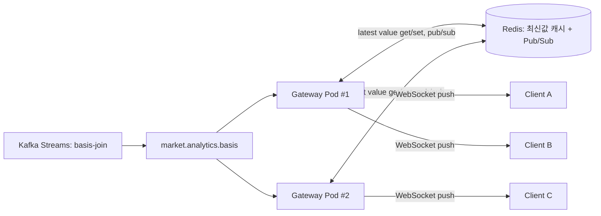

# Serving App — 실시간 인사이트 서빙 계층 설계

> 데이터 원본: [Insight 1-1 plan.md](../Insights/1.spot_futures_basis/1_1_plan.md) §4.4의
> `market.analytics.basis` 토픽 (Kafka Streams `basis-join`이 계산한 z-score/베이시스 결과)

Ingestion → Kafka Streams(분석)까지는 설계가 끝났지만, 그 결과를 **사용자가 웹사이트에서 실시간으로
보는 부분(서비스단)**은 아직 설계 전이었다. 이 문서는 "괴리율(베이시스) 같은 계산값을 사용자에게
실시간으로 보여주려면 서버를 어떻게 구성해야 하는가"를 정리한다.

---

## 1. 문제 정의

클라이언트가 최신 값을 보려고 각자 REST API를 주기적으로 폴링하면, 부하가 **클라이언트 수(N)에
비례**해서 늘어난다. 값이 바뀔 때만 서버가 알아서 밀어주는 **push 기반 구조**로 가야 클라이언트 수가
늘어도 원본 계산/조회 비용은 그대로 유지된다.

## 2. 전체 흐름

## 3. 고려 사항 1 — Polling vs Push

**질문**: 클라이언트가 값을 어떻게 받아갈 것인가?

- REST 폴링 — 구현 가장 단순 / 클라이언트 수만큼 요청이 선형으로 늘어남
- WebSocket/SSE push — 값이 바뀔 때만 서버가 전송 / 커넥션 상태 관리 필요

**결정: Push (WebSocket)**. Gateway가 `market.analytics.basis` 토픽을 구독하는 컨슈머를 프로세스당
하나만 유지하고, 값이 갱신될 때 연결된 모든 클라이언트에게 브로드캐스트한다. 컨슈머 개수는 클라이언트
수와 무관하게 고정이라, 원본 계산/조회 비용이 접속자 수에 영향받지 않는다.

## 4. 고려 사항 2 — 접속 직후 초기값 제공

**문제**: push만 하면 클라이언트가 접속한 시점과 다음 업데이트 사이에 공백이 생겨, 접속 직후엔 값이
없는 상태로 보인다.

**결정**: Redis에 "최신 값"을 항상 캐시해두고(`latest:{product}:{symbol}:basis` 등의 키), 클라이언트가
WebSocket에 접속하는 순간 Gateway가 Redis에서 캐시된 최신값을 1회 즉시 전송한 뒤, 이후부터는 push만
받는다. (README.md에 이미 Redis 역할로 "최신 가격·지표 캐시"가 명시돼 있어 재사용 가능 — 신규
인프라 불필요.)

## 5. 고려 사항 3 — Gateway 다중 인스턴스 스케일

**문제**: Gateway를 여러 Pod로 띄우면, 특정 클라이언트의 WebSocket 커넥션은 그중 한 Pod에만 붙는다.
`market.analytics.basis`를 구독하는 Kafka 컨슈머 그룹이 파티션을 나눠 가지면, 어떤 Pod는 특정
심볼의 업데이트를 아예 못 받아서 그 심볼에 붙은 클라이언트에게 값을 못 내려준다.

- **옵션 A**: 각 Gateway Pod가 `market.analytics.basis`를 컨슈머 그룹 없이 각자 전체 구독
  (모든 Pod가 모든 메시지를 다 받음) — 클라이언트 수와 무관하게 모든 Pod가 항상 최신 상태 유지 /
  Pod 수만큼 Kafka 구독 트래픽 중복
- **옵션 B**: Redis Pub/Sub을 fan-out 계층으로 추가 — 하나의 내부 컨슈머(또는 아무 Pod)가 Kafka에서
  값을 받아 Redis 채널에 publish, 모든 Gateway Pod는 Redis 채널만 구독 — Kafka 구독은 1곳,
  Redis Pub/Sub은 이미 캐시 용도로 쓰는 인프라 재사용

**결정: 옵션 B (Redis Pub/Sub)**. README.md가 Redis 역할에 "웹소켓 fan-out"을 이미 명시해둔 것과
일치하는 구조다. Kafka 컨슈머는 별도의 소규모 브릿지(또는 basis-join 자체)가 담당하고, Gateway
Pod들은 Kafka를 몰라도 되게 분리해 Gateway 쪽 책임을 "커넥션 관리 + Redis 구독"으로 단순화한다.

## 6. 고려 사항 4 — 업데이트 빈도 제어

**문제**: 업스트림(basis-join)이 짧은 주기로 값을 계속 갱신하면, 클라이언트 수만큼 브로드캐스트
트래픽이 그대로 곱해져서 커넥션이 몰릴 때 Gateway 부하가 튈 수 있다.

**결정**: Gateway가 심볼별로 최소 전송 간격(예: 최대 1회/초)을 두고, 그 사이에 들어온 업데이트는
가장 최근 값으로 덮어쓰기만 하고 실제 전송은 간격이 지날 때 1회만 한다 (디바운스/코얼레싱).
값 자체의 정확도(Redis 캐시)는 항상 최신으로 유지하되, 클라이언트로 나가는 트래픽만 상한선 아래로
묶는다.

## 7. 남은 이슈 / 다음 단계

- Gateway ↔ Redis Pub/Sub ↔ 클라이언트 구간의 정확한 프로토콜(WebSocket 메시지 포맷, 구독/해제
  방식)은 아직 미정 — 심볼별 topic 구독 방식으로 클라이언트가 관심 심볼만 받게 할지 결정 필요.
- Redis Pub/Sub은 at-most-once라 메시지 유실 가능성이 있음 — "최신 값"만 중요한 이 유스케이스에는
  허용 가능하다고 보되, 유실 시에도 다음 업데이트에서 자연히 복구되는지 확인 필요.
- 인증/인가(누가 어떤 심볼을 볼 수 있는지)는 이 프로젝트 스코프에서 아직 다루지 않음 — 학습 목적
  단일 사용자 가정으로 우선 진행.
- Gateway 자체의 Active-Active/스케일 정책은 [ingestion/plan.md 고려 사항 2](../plan/ingestion/plan.md)의 Ingestion Pod HA 논의와는
  별개로, Gateway는 상태를 안 들고 있는 stateless 구조라 단순 replica 스케일만으로 충분할 것으로
  보임 (재검토 필요).
